# PCAT


## Purpose

I use PCAT when the number of sources or other components is part of the
question. How many do the data support, and what can I infer about each one?
In a crowded field, even the membership of the catalog can be uncertain.

Each model fixes its parameter dimension. A metamodel
combines candidate models with different dimensions. PCAT supports inference
within one model, where
the parameter dimension stays constant, and inference over a metamodel, where
the sampler jointly explores the selected model and its parameters. Catalogs
are one application of metamodel inference. Their variable-size populations
can be inferred alongside shared parameters such as backgrounds and population
hyperparameters.

PCAT supports two complementary inference modes.

- inference within one model for physical, nuisance, and shared parameters
- inference over metamodels whose candidate models can have different
	parameter dimensions

Applications include

- probabilistic source catalogs from images and photon-count data
- crowded-field detection and membership uncertainty
- strong-lens and substructure forward modeling
- deterministic Gaussian-PSF scene formation through `pcat.image.forward_model_image`
- spectral-line decomposition with configurable intrinsic profiles and
	instrument line-spread functions
- variable-size source, flare, and planet populations
- Gaussian, exponential, FRED, and Davenport flare profiles

[Daylan, Portillo, and Finkbeiner (2017)](https://doi.org/10.3847/1538-4357/aa679e)
introduced the core method for gamma-ray point-source populations. The maintained examples extend the framework to
Gaussian mixtures, strong gravitational lenses, spectral lines, catalog
association, and detector point-spread functions.

## Posterior samples

`pcat.sample(typeplotback='dark', ...)` selects black plot backgrounds with
white axes for that call. The default is white with black axes, or the theme
already selected through TDpy. The caller's plotting settings are restored
after sampling. Both `plot_grid` and `plot_population_grid` accept
`typeplotback`. Dark population-grid outputs use a `_dark` suffix to avoid
reusing cached light plots.


Each synchronized frame combines eight evolving inference views with the
static PCAT logo in the center. The data panels start from nonempty catalogs,
follow burn-in for the first third of the animation, and show posterior samples
for the remaining two thirds. They show an unbinned Gaussian mixture of
simulated events, Daylan+2017 northern Galactic cap Fermi-LAT point sources,
the observed JWST/MIRI NGC 7027 spectral fit, a stellar light curve with a
variable number of rotating starspots, and the Roman/WFI lens's outer arc and
compact inner counterimage, plus stellar flares, radial velocities, and transit
times. The Roman source is one extended Gaussian. The simulation includes no
independent point source. Time-series and spectral axes remain fixed across frames. The
publication-inspired simulations illustrate PCAT's sampling behavior and do not
reproduce published posterior values.

## Every proposed state

Enable `makeanim=True` for a retained-state animation and
`boolmakeanimprop=True` to also record every proposed candidate before the
Metropolis-Hastings decision, whether accepted or rejected. The retained-state
animation shows frames from at or after burn-in at `numbswepplot` cadence. The candidate
animation overlays current and proposed models on the data in one panel and
compares both data-minus-model residuals in another. Colors and arrows show the
proposed state change. Frames label the proposal type, acceptance probability,
decision, proposal-density ratio, and Jacobian. Rejected candidates remain
visible as proposals, not posterior samples. Within-model frames identify the
Gaussian, differential-evolution, or Student-t subtype. The example also
reports proposal counts and exercises within-model, birth, death, split, merge,
and jump moves.

Run the example to generate both GIFs under
`examples/proposal_state_animation/visuals/post/anim/`:

```bash
python examples/proposal_state_animation/proposal_state_animation.py --numbswep 120
```

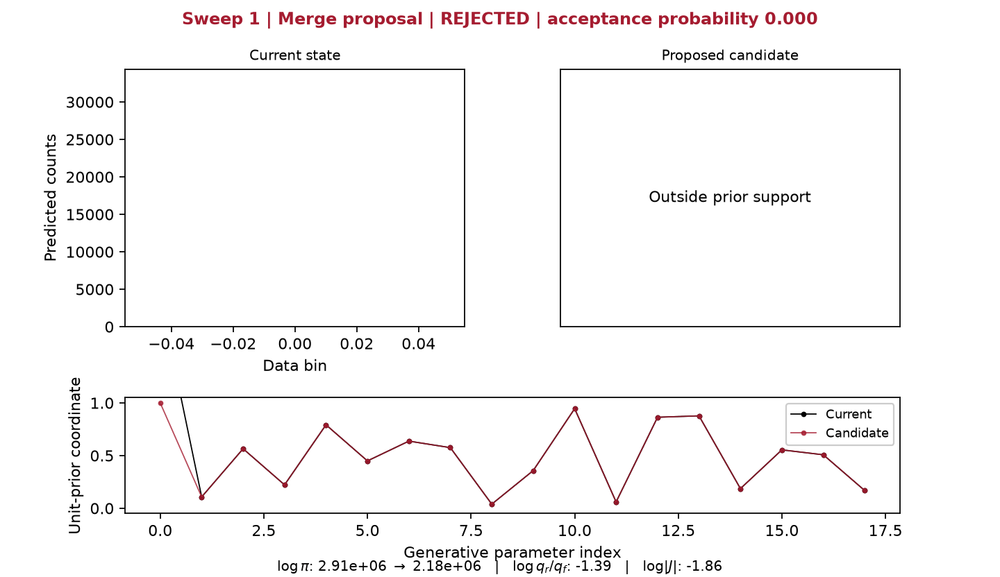

The matching retained-state sequence from the same short simulated Voigt-line
run is shown below. It contains frames only at `numbswepplot` cadence, while the
candidate animation contains all 120 sweeps.

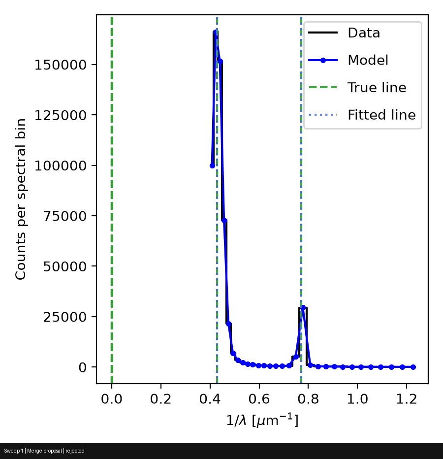

### Jacobian in split and merge moves

PCAT splits a parent amplitude-coordinate value $F$ into $rF$ and $(1-r)F$.
This amplitude-fraction transformation contributes $\log|J|=\log F$ to the split acceptance ratio.
The reverse merge uses the negative term. The example records the unclipped log
acceptance ratio, then compares each prior-valid proposal with a counterfactual
that omits only the Jacobian. Its acceptance curves show how the median
split/merge Jacobians change acceptance probability at a fixed remainder of the
ratio. The counterfactual is not a second chain.

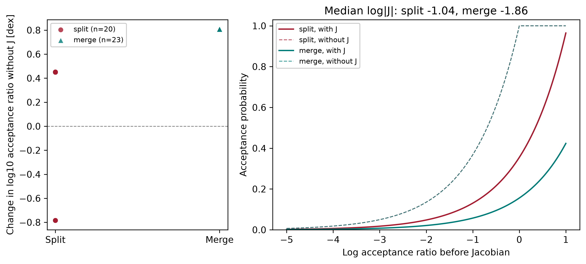

The same example animates jumps between two one-parameter models for the same
positive amplitude: linear ``A`` and logarithmic ``eta = log(A)``. Their prior
densities differ by the change of variables. With equal model priors,
``p(eta) / p(A) = A`` and the forward Jacobian is ``1/A``, so the complete
acceptance ratio is one. Removing the Jacobian makes the reverse jump accept
with probability ``1/A`` and biases occupancy toward the logarithmic
parameterization, even though both models encode the same physical value.


## Package organization

PCAT's public sampling APIs live in `pcat.sampling`. `pcat.main` remains
available for backward compatibility. Fixed-dimensional inference, diagnostics,
plotting, catalog association, paths, and PSF utilities have dedicated modules
under `pcat/`.

### Deterministic image formation

`pcat.image.forward_model_image` convolves a finite two-dimensional source
scene with a normalized Gaussian PSF and adds a uniform background. It returns
the intrinsic scene, kernel, and predicted image without running inference or
drawing noise. Run the explicitly simulated two-source example with:

```bash
python examples/image_forward_model/image_forward_model.py --typefileplot png
python examples/image_forward_model/image_forward_model.py --typefileplot png --bokeh
```


Install `python -m pip install -e '.[bokeh]'` to create the interactive companion at `examples/image_forward_model/visuals/pcat_image_forward_model.html`.

### Cubic subpixel PSF evaluation

For Cartesian point-source images, `kernevaltype="bspx"` evaluates a cached
ten-term cubic polynomial in source subpixel shifts. The default `"ulip"`
evaluates the direct radial profile at each source-to-pixel separation. The
selected-pixel calculation contracts the fitted coefficients, and they are
rebuilt when the PSF changes.

Sampled accuracy failures, negative or nonfinite polynomial values, and
positions outside the table use direct evaluation. The sampled check uses
0.1 percent of the profile peak and is not a uniform or likelihood-error
bound. No flux renormalization or clipping is applied. Compare results with
the direct path for the intended image, PSF width, and signal level.

The benchmark separates setup time from repeated evaluation cost. In the
synthetic double-King case, 600 evaluations were 1.4x faster for 3 energy bins
and 3.7x faster for 16, with maximum held-out errors of $4.8\times10^{-4}$ of
the profile peak. That case uses two quality classes, an 81-pixel cutout, a
0.01-degree pixel scale, and core and tail widths of two and four pixels.
These synthetic timings vary with configuration and workload. They do not
establish posterior equivalence or adequacy for observed data. Savings depend on the
energy/quality axes, source cutout size, and how often the PSF changes. The
coefficient table grows with Cartesian grid span, so large images can have
substantial memory and construction costs.

```bash
python examples/psf_cubic_interpolation/psf_cubic_interpolation.py --evaluations 600 --repeats 3
python examples/psf_cubic_interpolation/psf_cubic_interpolation.py --evaluations 600 --repeats 3 --bokeh
```


The interactive timing and accuracy panels are available in
[Bokeh HTML](docs/_static/cubic_psf_benchmark.html). The example writes the
same view under its local ``visuals/`` directory when run with ``--bokeh``.

## Inference methods

### Fixed-dimensional inference

In fixed-dimensional inference the parameter count and selected model stay
constant throughout a chain. PCAT updates the model parameters and any
fixed-dimensional nuisance or population parameters with its native proposals,
priors, persistence, convergence tools, and final processing. Use
`pcat.fixed.sample_posterior` for a compact interface that returns samples keyed
by parameter name, or `pcat.fixed.sample_fixed` to configure the native pipeline
directly.

### Transdimensional metamodel inference

A metamodel is a collection of candidate models whose parameter dimensions may
differ. PCAT samples the model index and the parameters together, including
shared parameters that remain in every candidate. For example, a source-catalog
metamodel can vary the number of sources while also sampling background
normalizations and population hyperparameters. Catalog inference is one
transdimensional application of this more general approach.
Each model fixes its parameter dimension. A metamodel combines candidate models
with different dimensions.

## Custom likelihoods

Likelihood construction is separate from model dimensionality. A model or
metamodel defines the candidate parameterized predictions. The likelihood
scores those predictions against data. To use a custom likelihood for
inference within one model, define a callback with signature
``retr_llik(gdat, strgmodl, values)`` that returns the log likelihood only.
Configure priors separately, then pass the callback to `sample_fixed`:

```python
from pcat import sample_fixed

result = sample_fixed(
	retr_llik=log_likelihood,
	parameter_names=("mean", "scale"),
	prior_types=("self", "gaus"),
	prior_minima=(-5.0, 0.0),
	prior_maxima=(5.0, 5.0),
	prior_means=(0.0, 1.0),
	prior_stdvs=(1.0, 0.2),
	initial_values=(0.0, 1.0),
	proposal_scales=(0.05, 0.05),
	proposal_correlation=((1.0, 0.3), (0.3, 1.0)),
	pathbase="/path/to/project-root",
	strgcnfg="fixed-example",
)
```

``"self"`` parameters have uniform priors between their minima and maxima.
``"gaus"`` parameters use the specified means and standard deviations. PCAT
proposes in unit-prior coordinates and applies its inverse-CDF transforms.
Generic fixed-dimensional runs set birth/death and split/merge probabilities to
zero, so only the native type-0 within-model proposal is active. The returned
object is the persisted ``gdatfinlpost`` state.

## Proposal types and mixing moves

For quick inference within one model, ``pcat.fixed.sample_posterior`` accepts a
likelihood with signature ``retr_llik(para, gdat)`` and returns a dictionary of
posterior samples keyed by parameter name, optionally with derived variables,
trace plots, and a saved posterior summary. It runs several independent PCAT
chains and discards their burn-in.

By default, type-0 moves perturb one parameter at a time. Set
``probpropblock`` above zero to mix in correlated block moves using
``proposal_correlation``. ``factpropblock`` scales those block increments.
These moves retain PCAT's standard acceptance, adaptation, persistence, and
final-processing machinery. Set ``probdemc`` above zero to mix in
differential-evolution jumps (ter Braak 2006) drawn from a bounded history of
the chain's own visited states (``numbdemchist``, default 1,000 states). This
proposal is symmetric, so it needs no change to the acceptance ratio and can
help mixing when parameters are correlated in ways ``proposal_correlation``
does not capture.

For transdimensional runs (``numbpopl`` > 0), set ``probjump`` above zero to
mix in a dimension-preserving jump: one randomly chosen existing element is
redrawn entirely from its own prior, holding the number of elements fixed.
Because the redrawn element's prior exactly cancels its independence-proposal
density, its acceptance ratio is the plain likelihood ratio, with no Jacobian
or transition-probability term. This can help the sampler escape local optima
in element parameters (e.g. near-degenerate positions) that birth, death,
split, and merge moves reach only indirectly.

Within-model updates can also mix in ``probstud`` Student-t(5) steps. These
independent, variance-matched increments have heavier tails than the default
Gaussian random walk and use the same symmetric Metropolis acceptance. They
apply to fixed-dimensional parameters and existing catalog elements without
changing catalog size. ``probdemc + probstud`` must be at most one. In a seeded
8,000-sweep comparison on the bimodal target, the Student-t mixture improved
mode switches from 5 to 17 and ESS per second from 0.2 to 1.8. On the correlated
Gaussian target it reduced ESS per second from 3.9 to 2.2. Its performance
depends on the target.

### Neural birth proposals

I provide an optional conditional neural density for proposing transdimensional
births and prior-redraw jumps. Install the extra with ``python -m pip install 'pcat[neural]'``. Train
it on simulated pairs of fixed-length observation features and element
parameters in unit-prior coordinates. The RV benchmark features 128 trial
periods with log periodogram power, unit-scaled amplitude, and sine/cosine
phase. The fitted mixture includes a uniform
component, keeping proposal density positive across the full prior volume.
Freeze the fitted proposal before production sampling. PCAT uses its exact log
density in birth/death and jump Hastings corrections.

```python
from pcat import NeuralElementProposal, sampling

proposal = NeuralElementProposal.fit(
	condition_features,
	simulated_element_parameters,
	uniform_fraction=0.05,
	seed=12,
)
proposal.save("analysis/neural_birth.pt")
proposal = NeuralElementProposal.load("analysis/neural_birth.pt")

result = sampling.sample(
	**run_configuration,
	neural_proposal_features=features_for_this_run,
	probtran=0.4,
	**proposal.callbacks(),
)
```

The feature vector supplied at sampling must follow the same definition used
to create ``condition_features``. The neural density proposes candidate
elements while PCAT's transdimensional sampler and posterior target remain
unchanged. On held-out simulations, compare posterior recovery and effective
sample size per unit compute alongside the acceptance fraction. See
``docs/sampling.rst`` for the callback and correction details.

For a density that also depends on the live catalog, train on conditions built
from simulated catalog states and use the paired state-conditioned callbacks.
The feature builder must be a module-level, picklable callable because PCAT
serializes run configurations for worker chains.

```python
import numpy as np

def retr_proposal_condition(gdat, context):
	return np.concatenate((
		gdat.neural_proposal_features,
		np.asarray(context.element_counts, dtype=float),
	))

state_callbacks = proposal.state_callbacks(retr_proposal_condition)
result = sampling.sample(
	**run_configuration,
	neural_proposal_features=features_for_this_run,
	probtran=0.4,
	**state_callbacks,
)
```

The training conditions must use the same observation features and catalog
summary. A death's reverse-birth density uses the catalog after the removed
element is omitted. The default radial-velocity efficiency benchmark uses the
data-only callback. A flat-likelihood regression recovers a uniform
zero-to-three-element count prior with a normalized count-conditioned proposal.
This verifies posterior recovery for one target configuration. Proposal
efficiency and posterior coverage across other targets remain unmeasured. A
400-sweep state-conditioned smoke run on one held-out scene failed count-posterior
agreement. Total-variation distances were 0.32 from the prior and 0.75 from the
data-informed baseline. The run confirms that the benchmark executes.
Comparative performance remains unmeasured.
For a multi-scene comparison, use a fresh run ID and pass
``--proposal-conditioning state`` to the benchmark script.
To test the residual-conditioned variant, add
``--state-feature-mode residual``. It computes the periodogram from the
velocity residual after subtracting the current catalog model. A one-scene
smoke run confirms that this mode executes. Comparative performance remains
unmeasured.

In a completed three-scene run with 12,000 sweeps per chain, state-conditioned
count ESS per likelihood call was 0.029 times the prior value (95% scene-
bootstrap interval 0.029 to 0.60) and 1.20 times the data-informed value (0.11
to 1.53). Median count-posterior total variation was 0.44 from prior and 0.57
from data-informed. The count ESS per call versus prior and the count-posterior
agreement both failed the pre-specified criteria. Log-likelihood R-hat was
1.35, 1.00, and 2.32 across the three scenes, exceeding 1.1 in two scenes.
The gain check failed against both baselines for this training setup. Results
for other state-conditioned proposals remain open.

When building an RV configuration with ``retr_dictpcatrvel``, set
``boolmakepropelem=False`` before adding state callbacks. The helper otherwise
installs its data-only matched-filter proposal by default.

The paired [RV efficiency benchmark](examples/neural_proposal_efficiency/neural_proposal_efficiency.py)
trains on separate simulated systems and compares prior, existing data-informed,
and neural element proposals on held-out two-planet scenes. The default uses
five scenes and two independent chains per method and scene, reporting count
and log-likelihood R-hat and ESS, posterior agreement, ESS per call, run ESS
per second including proposal setup, and training-amortized ESS per second. Its
short ``--smoke`` mode checks that the pipeline runs. Assess efficiency and
posterior agreement with the multi-scene run.

## Sampler utilities

Sampler controls and diagnostics are separate from scientific applications
such as Keplerian signals in radial-velocity data.

### Dynamic convergence-based stopping

By default PCAT checks convergence and stops after repeated passing checks,
using split-chain (or, with ``numbproc`` > 1, genuinely cross-chain)
Gelman-Rubin R-hat combined with an effective-sample-size (ESS) floor computed
from the autocorrelation time. ``numbswep`` remains the maximum sweep count if
the convergence criterion is not met. Set ``boolcheckconv=False`` to use a
fixed sweep count. Relevant settings:

- ``numbsampconvmin``: minimum number of retained samples before the first
	check is attempted (default 500).
- ``numbsampconvcheck``: how often (in retained samples) to re-check
  convergence after the minimum is reached.
- ``maxmconvrhat``: maximum split-chain/cross-chain R-hat to accept as
  converged (closer to 1 is stricter).
- ``numbsampconveffc``: minimum ESS to accept as converged.
- ``numbconvpass``: number of consecutive passing checks required before
  sampling stops (guards against a single lucky check).

With ``numbproc`` == 1, R-hat/ESS are computed by splitting the single chain
in half. With ``numbproc`` > 1, each worker shares its running convergence
statistics with the others via a ``multiprocessing.Manager``-backed
dictionary, and R-hat/ESS are computed genuinely across all worker chains.
Once every worker independently observes the shared stop signal, all workers
stop and their retained samples are truncated to a common length before
final aggregation. Fixed-length runs remain available by explicitly disabling
``boolcheckconv``.

Plot-enabled runs also save a convergence figure suite under
``visuals/post/convergence/``. Fixed parameters have worker traces,
autocorrelation, approximate effective sample sizes, and cross-worker R-hat.
Variable-size catalogs have element-count traces, occupancy, within-worker
transitions, count mixing, and early/late distributions of sampled element
features. Single-worker runs cannot report cross-worker R-hat. Existing saved
posteriors can be plotted with ``pcat.plotting.plot_posterior_convergence``.

The variable-planet radial-velocity example produces the following fixed-parameter
and planet-count traces from its short demonstration chain. They show how to
inspect mixing. The run is too short to establish convergence.

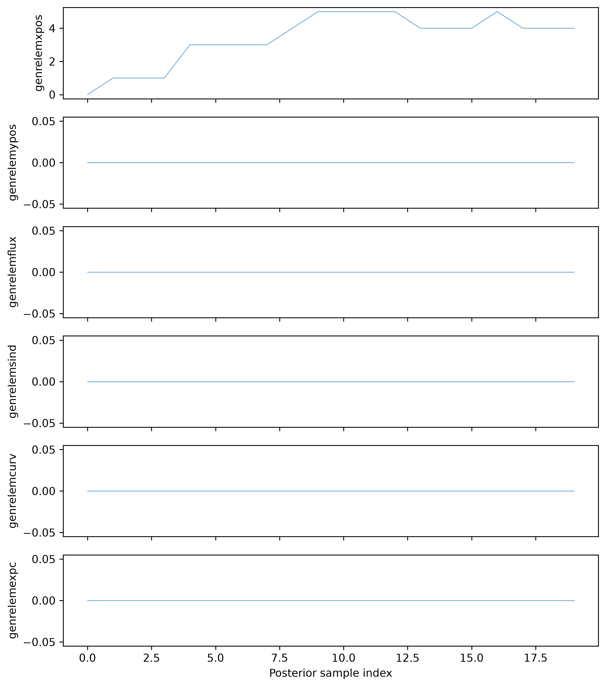

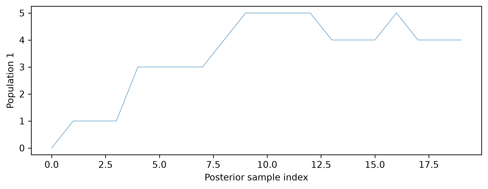

### Information estimates

Call ``pcat.diagnostics.estimate_kl_divergence`` when a forward KL estimate is
needed. It computes the sample mean of ``log p - log q`` from PCAT draws from
``P`` and normalized log-density callbacks for ``P`` and ``Q``. Its reported
Monte Carlo error accounts for chain autocorrelation. Finite-sample estimates
are not clipped at zero. The ``kl_divergence_gaussian`` example compares a PCAT
posterior-to-prior estimate with the exact Gaussian value.

For dependence between two parameter groups, use
``pcat.diagnostics.estimate_mutual_information`` with normalized joint and
marginal log densities. It estimates ``I(X;Y) = D_KL(p(X,Y) || p(X)p(Y))`` in
nats from joint draws. Columns before ``split_index`` form the first group,
and the remaining columns form the second. No marginal density is fitted
automatically. Its Monte Carlo error uses the same chain-aware calculation as
the KL estimate, and finite-sample estimates can be negative.

The same Gaussian example evaluates both quantities from its PCAT chains and
compares each with its analytic value. The first measures change from prior to
posterior, while the second measures dependence within the posterior. These
calculations alone do not establish chain convergence.

```bash
python examples/kl_divergence_gaussian/kl_divergence_gaussian.py
```

The [executed notebook](examples/kl_divergence_gaussian/kl_divergence_gaussian.ipynb)
retains the sampled posterior, displays its summary, and generates both figures.


### Burn-in strategies

`numbburn` sets the initial sweeps excluded from posterior products. PCAT offers
two complementary burn-in options through the same sampler pipeline.

- `booladaptstdp=True` applies Robbins-Monro proposal-scale adaptation during
	burn-in and freezes the scales afterward.
- `boolburntmpr=True` tempers the likelihood during the first
	`factburntmpr` fraction of burn-in. The inverse likelihood temperature rises
	quartically from near zero to one while the prior remains untempered.

The [interactive notebook](examples/burn_in_strategies/burn_in_strategies.ipynb)
and maintained script compare fixed scales, adaptive scales, likelihood-
temperature annealing with adaptive scales, and adaptive Student-t within-model
proposals on two seeded targets: a correlated Gaussian and an equal-weight
bimodal target. They report post-burn acceptance, effective samples per second,
target-summary error, runtime, and the recorded inverse-temperature schedule.

```bash
python examples/burn_in_strategies/burn_in_strategies.py --numbswep 1200
```

Each execution keeps its sampler output under a distinct timestamped benchmark
directory in the example's `data/` directory. The three comparison figures share
that run tag and are written directly into `visuals/`. Earlier sampler results
and figures are preserved, and repeated attempts to save the same figure refuse
to overwrite it. Each run saves acceptance fractions, effective sample sizes,
target-summary errors, runtimes, and relative sampler-cache paths in its
`metrics.json` file. It also saves the sampled arrays and temperature histories
in `posterior_arrays.npz`. The example's `load_benchmark()` function reads those
two files for replotting without unpickling the likelihood callback. Use a new
figure run tag when creating another layout so the earlier images stay intact.

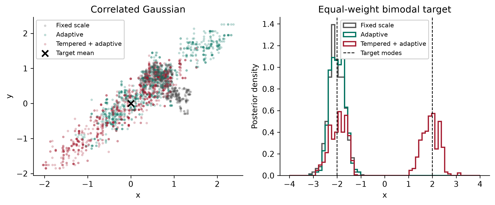

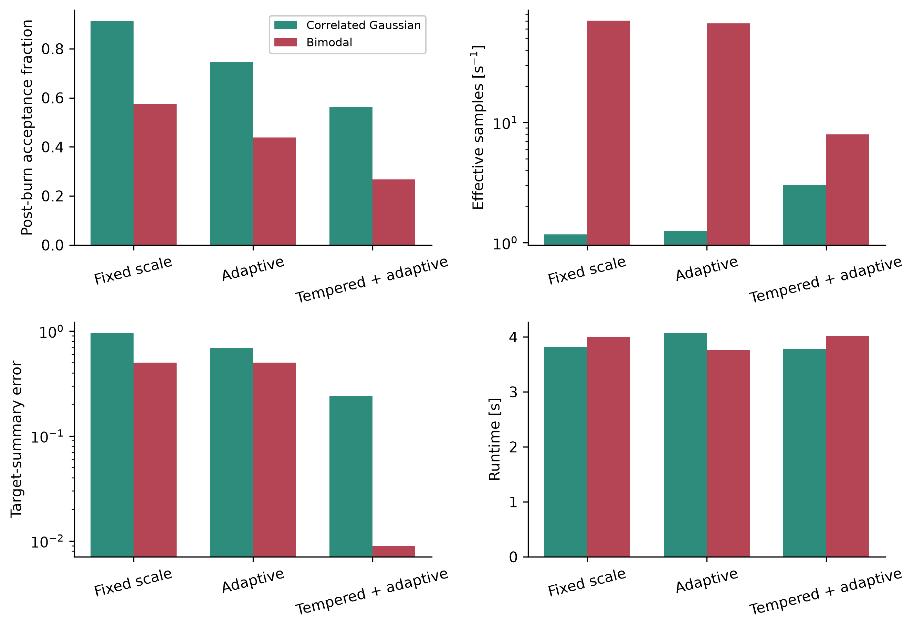

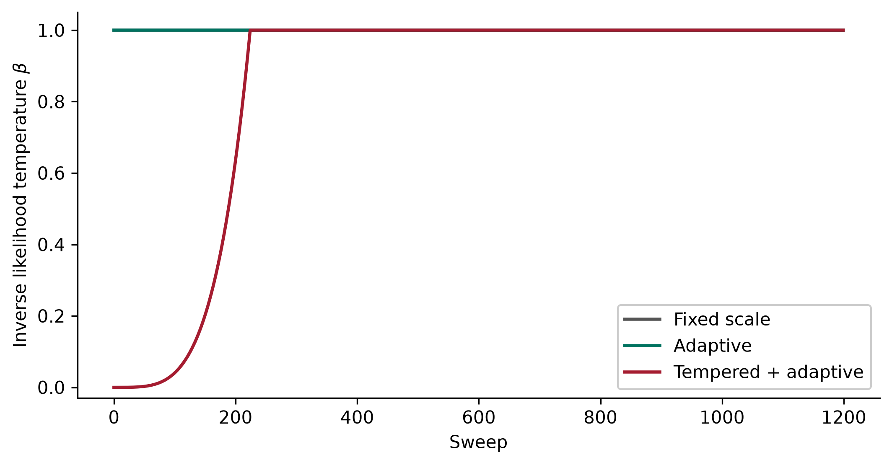

For the intentionally underscaled correlated-Gaussian proposals, tempered plus
adaptive burn-in raises the effective sample size from 4.5 to 11.4 and reduces
the retained-mean error from 0.97 to 0.24. The Student-t mixture also reaches
the second mode more often, but is less efficient on the correlated Gaussian.
These values describe short controlled simulations, not universal rankings.

`typeopti="hess"` estimates curvature with finite differences to initialize
proposal scales. It leaves the starting state unchanged. PCAT has no
gradient-based burn-in mode.

### Comparing samplers

The [PCAT, emcee, and dynesty example](examples/sampler_comparison_emcee_dynesty/sampler_comparison_emcee_dynesty.ipynb)
compares all three on the same sinusoidal model with one parameter dimension,
using posterior agreement, mode recovery, effective samples per second,
likelihood calls, and evidence. A second experiment compares variable planet
counts from zero to three. PCAT samples all counts in one run, while dynesty
needs a separate evidence run per count. In this comparison, emcee requires one
parameter dimension per chain and cannot make that comparison. The example reports count-posterior
agreement, period recovery, likelihood evaluations, and wall time. No sampler
leads on every metric in these two seeded simulations.

Run both comparisons with:

```bash
python examples/sampler_comparison_emcee_dynesty/sampler_comparison_emcee_dynesty.py --part both
```


## Applications

### [Daylan et al. (2017) Unresolved Fermi-LAT sources](examples/daylan+2017_fermi_point_sources/)

### [Daylan et al. (2018) Strong-lens subhalos](examples/daylan+2018_strong_lens_subhalos/)

### [Keplerian signals in radial-velocity data](examples/variable_number_exoplanets_radial_velocity/variable_number_exoplanets_radial_velocity.ipynb)

``pcat.radial_velocity.retr_dictpcatrvel`` configures a transdimensional search
for a variable number of planets in a stellar radial-velocity (RV) time series.
Each element is a Keplerian orbit with semi-amplitude, period, mean anomaly,
eccentricity, and argument of periastron. The Gaussian likelihood marginalizes
one velocity offset per instrument (and optionally a linear trend) analytically
and a common stellar jitter numerically on a log-uniform grid. Births and jumps
draw periods from a periodogram-weighted density with the matching Hastings
correction, which is what makes narrow periodogram peaks reachable. In
`examples/variable_number_exoplanets_radial_velocity/`, 100,000 sweeps over 120
simulated epochs take about 1.5 minutes and assign 92% posterior probability to
the injected three planets in the recorded run. The model permits zero to five
planets and represents each with period, semi-amplitude, eccentricity, argument
of periastron, and mean anomaly. The simulation has seasonal gaps, two
instrumental zero points, 1.5 m/s reported uncertainties, and 2 m/s added white
jitter. All data are simulated. The short smoke configuration checks that the
pipeline runs. Use the full demonstration to assess convergence.

Run the full demonstration or its short smoke configuration from the repository
root:

```bash
python examples/variable_number_exoplanets_radial_velocity/variable_number_exoplanets_radial_velocity.py --numbswep 100000
python examples/variable_number_exoplanets_radial_velocity/variable_number_exoplanets_radial_velocity.py --smoke
```


### Roman strong-lens catalogs

The executable example uses the compact PCAT Roman benchmark to simulate 100 strong-lens images. Half contain one dark-matter perturber drawn at a candidate position around the macro Einstein ring, and half contain no perturber. The catalog approximation compares zero- and one-perturber models after Roman point-spread-function convolution and Poisson plus read noise. The figure follows one representative lens from simulated detector input through the macro-only model and residual, then summarizes the final population-level catalog probabilities.

```bash
python examples/roman_strong_lens_perturber_catalog/roman_strong_lens_perturber_catalog.py --typefileplot png
```

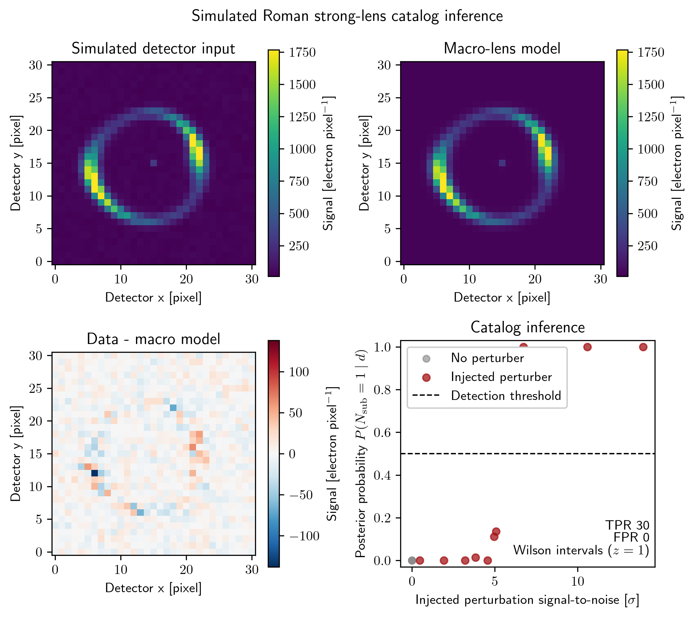

For the fixed seed, the approximate catalog classifier recovers 38% of injected perturbers above a posterior threshold of 0.5, with a 68% Wilson interval of 31% to 45%. It produces no false positives among the 50 null lenses, with an upper interval bound of 2%, and localizes 84% of injected perturbers to the correct candidate position. The mean one-perturber posterior probability is 0.37 for injected systems and $4.6\times10^{-5}$ for null systems. These values characterize this clearly labeled simulation and are not forecasts from real Roman observations.

### Mejiro Roman strong-lens inference

The [Python example](examples/mejiro_roman_strong_lens/mejiro_roman_strong_lens.py) and [notebook](examples/mejiro_roman_strong_lens/mejiro_roman_strong_lens.ipynb) show mejiro simulating the SLSim ``SampleGG`` galaxy-galaxy lens in Roman WFI F129, then using PCAT to infer the lens and source parameters from the simulated Poisson exposure. The likelihood uses the same lenstronomy model as the simulation. Four chains start from random prior draws. A second fit assumes a PSF 30% wider than the simulated one. Every image in this example is simulated. Roman has not observed these systems. Running it requires an editable mejiro install and ``roman-technical-information``.

Run a short pipeline check from the repository root with:

```bash
python examples/mejiro_roman_strong_lens/mejiro_roman_strong_lens.py --smoke
```

Omit ``--smoke`` for the full 60,000-sweep run. The example also compares the posterior fit with the simulated exposure:

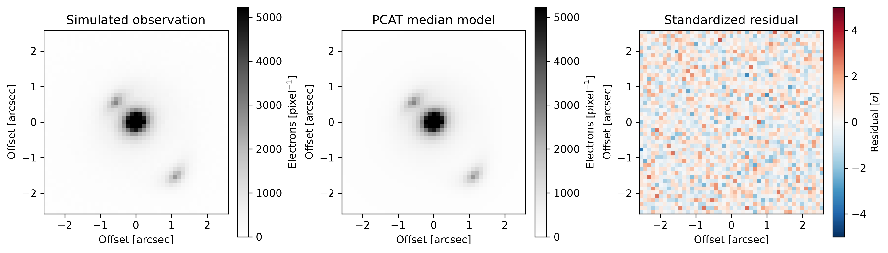

### Model misspecification

The [flare-catalog script](examples/mismodeling_flare_catalog/mismodeling_flare_catalog.py) and [notebook](examples/mismodeling_flare_catalog/mismodeling_flare_catalog.ipynb) compare fits using the data-generating models with fits using different forward models. Four fast-rise, exponential-decay (FRED) flares are injected into each simulated light curve. One fit replaces the asymmetric FRED profiles with symmetric Gaussian flares. Another replaces a 2% modulated baseline with a constant level. In the recorded run, the Gaussian fit reports 15.1 flares on average instead of four, despite a chi-squared per bin of 0.99, close to 0.97 for the correct model.

Run a short check with:

```bash
python examples/mismodeling_flare_catalog/mismodeling_flare_catalog.py --smoke
```

Omit ``--smoke`` for the default 40,000 sweeps per chain. The [Mejiro comparison above](#mejiro-roman-strong-lens-inference) provides a separate image-model example: it fits one simulated exposure with the correct PSF and with a PSF 30% too wide, then measures the resulting lens-parameter bias.

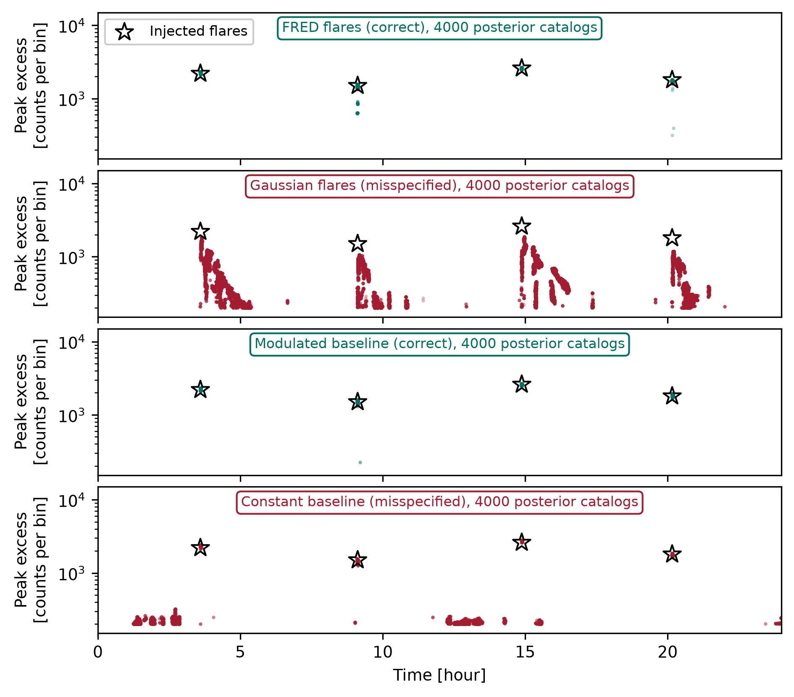

Full transdimensional runs initialize a model configuration, define a likelihood and data product, and call `pcat.sampling.init(...)` with a populated configuration dictionary.

### Rubin-like cluster lens

The interactive
[`simulated_rubin_cluster_lens.ipynb`](examples/simulated_rubin_cluster_lens/simulated_rubin_cluster_lens.ipynb)
notebook fits a synthetic, single-band image of a circular cluster-scale lens.
The simulation uses 0.2 arcsec pixels and 0.7 arcsec Gaussian seeing. PCAT
samples the Einstein radius and two source coordinates with a Poisson image
likelihood.

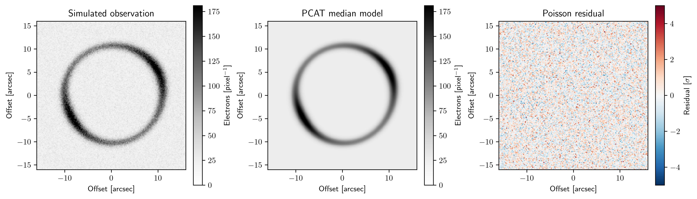

The example fixes the source morphology, total brightness, sky background, and
seeing at their injected values. It omits foreground galaxy light, neighboring
cluster members, correlated sky noise, and point-spread-function uncertainty.
This controlled simulation demonstrates parameter recovery. It makes no
prediction about Rubin Observatory performance or real observed data.

## Installation

A modern installation path is:

```bash
cd /path/to/pcat
pip install -e .
export PCAT_PATH=/path/to/pcat
```

`PCAT_PATH` identifies the Git repository root. Its `data/` and `visuals/` directories are ignored by Git. PCAT stores run inputs and outputs under `data/pcat_runs/` and run figures under `data/pcat_runs/<run>/visuals/`.

The package declares `tdpy` and `chalcedon` as runtime dependencies. To develop against local source checkouts, install both libraries before PCAT:

```bash
cd /path/to/tdpy
pip install -e .
cd /path/to/chalcedon
pip install -e .
cd /path/to/pcat
pip install -e .
```

## Outputs

PCAT writes serialized posterior states under `data/` and figures under
`visuals/`, rooted at the configured run directory. Products include input data,
posterior model realizations, residuals, inferred source populations, parameter
distributions, convergence summaries, and animations. Example-specific figures
remain beside their workflows under `examples/*/visuals/`.

## Posterior plotting

PCAT can render every one- and two-parameter posterior projection without an
external corner-plot package:

```python
from pcat import plot_grid

plot_grid(
	"/path/to/posterior",
	"model",
	result.listpostparagenrscalbase,
	("mean", "scale"),
	typefileplot="pdf",
)
```

`plot_population_grid` compares several labeled sample populations. It draws a
corner plot, one-dimensional histograms, and pair-wise scatter plots, and it
accepts log-scaled parameters, categorical parameters, and reference draws:

```python
from pcat import plot_population_grid

plot_population_grid(
        [["Mass", "M$_\\odot$"], ["Radius", "R$_\\odot$"]],
        listpara=[samples_detected, samples_all],
        listlablpopl=["Detected", "All"],
        pathbase="/path/to/visuals/",
        boolplottria=True,
)
```

## Evidence estimation

For normalized bounded or Gaussian priors, `estimate_evidence` fits a proposal
to posterior draws and evaluates the likelihood on independent draws from a
mixture of that proposal and the prior:

```python
from pcat.diagnostics import estimate_evidence

evidence = estimate_evidence(
    result.listpostparagenrscalbase,
    lambda values: -0.5 * ((values[0] - 0.3) / 0.1) ** 2,
    prior_types=('self',),
    prior_minima=(0.0,),
    prior_maxima=(1.0,),
)
print(evidence['log_evidence'], evidence['relative_error'])
```

The result also includes `effective_sample_size`. The relative error describes
Monte Carlo uncertainty in the evidence, approximately the uncertainty in log
evidence when small. Repeat the estimate with more draws if the effective sample
size is low. A custom prior needs its normalized density and sampling rule before
evidence can be estimated this way.

## Documentation

The user guide begins at [`docs/index.rst`](docs/index.rst) and covers
installation, runnable examples, output products, diagnostics, and the public
API. Build the HTML documentation with:

```bash
python -m pip install -e ".[docs]"
python -m sphinx -E -a -W --keep-going -b html docs docs/_build/html
```

## References

- [Daylan, Portillo, and Finkbeiner (2017)](https://doi.org/10.3847/1538-4357/aa679e), *Inference of Unresolved Point Sources at High Galactic Latitudes Using Probabilistic Catalogs*, The Astrophysical Journal, 839, 4
- Daylan (in preparation), *Neural-network proposals for transdimensional Bayesian inference with PCAT*. This forthcoming methods paper describes PCAT's sampler and its neural-proposal transition interface.
