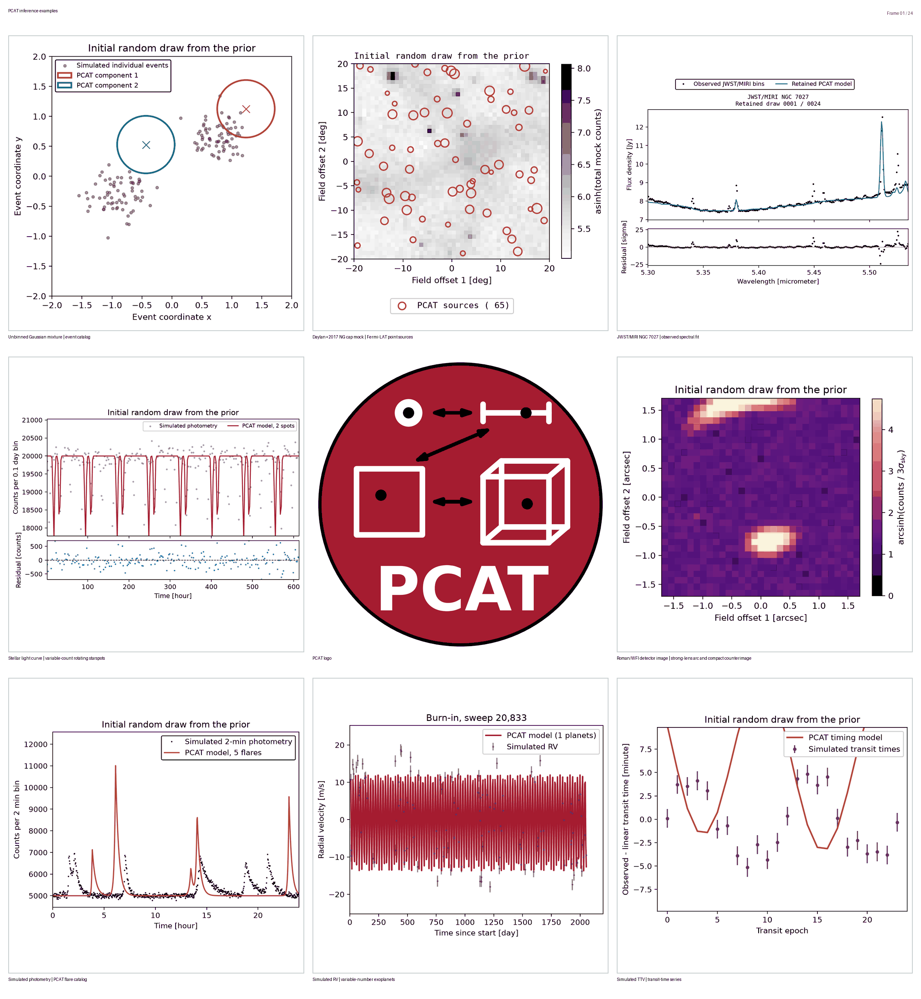

Examples
========

Every Python example under ``examples/`` has a corresponding Jupyter notebook
in the same directory. Open the notebook in VS Code or Jupyter to run it
interactively. The Python scripts remain available for automated and command-line
runs. The batch-command notebook lists its external commands without executing
them.

Pipeline demonstrations
-----------------------

``chandra_point_source_catalog``
   Compact Chandra-style point-source detection with simulated data.

``gaussian_mixture_catalog``
   Two-dimensional variable-width Gaussian-mixture inference with genuine
   birth and death transitions.

``unbinned_gaussian_mixture``
   PCAT fits the coordinates of 140 individually simulated events directly,
   without spatial count bins. Its notebook runs the sampler, reads the saved
   center posterior, and displays the generated event-catalog frames.

``transit_timing_variations``
   PCAT fits a sinusoidal timing perturbation to 24 individually simulated
   mid-transit times. Its notebook reads the timing posterior and displays
   the sampled model against the simulated timing residuals.

``neural_proposal_efficiency``
   Compares prior, data-informed, and neural birth proposals on held-out
   simulated radial-velocity scenes. Its companion notebook runs the actual
   training-and-sampling smoke path and displays the saved summary and figure.
   Two short chains per method check execution without establishing convergence
   or an efficiency advantage. Choose a fresh ``--run-id`` for each comparison.
   Existing benchmark artifacts or configured chain outputs are rejected before
   training starts. Use one process per run ID.
   Constant count traces receive zero ESS as a conservative reporting convention,
   including short traces. Missing or nonfinite samples raise an error. These
   conventions do not establish convergence.
   Efficiency ratios with a zero-ESS baseline are undefined and reported as
   ``NaN``. Their bootstrap intervals remain undefined and provide no evidence
   of an efficiency gain.
   Bootstrap inputs must be one-dimensional with a positive integer draw
   budget. Empty, masked, or nonfinite comparisons remain undefined without
   resampling or dropping scenes. Valid seeded intervals are unchanged.
   Identical constant count chains have undefined R-hat (``NaN``), while
   disagreeing constant chains retain infinite R-hat. Efficiency claims require
   finite per-scene R-hat values for both compared methods.
   Gain claims require unmasked, aligned per-scene evidence and ordered
   two-bound confidence intervals. Missing or malformed inputs fail the claim
   check without filling values, dropping scenes, or changing the thresholds.
   ESS and R-hat share missing-sample validation. R-hat checks each full input
   trace before selecting equal-length tails, preserving the existing
   calculation for valid unequal-length chains.
   Aggregate count R-hat medians retain every validation scene. An undefined
   per-scene value leaves the corresponding median undefined, without dropping
   scenes or emitting an all-undefined median warning.
   Per-chain call counts must be positive integers, elapsed times finite and
   positive, and training overhead finite and nonnegative. Missing overhead
   retains its zero default. Invalid costs are rejected before aggregation,
   and integer call totals are accumulated without truncation.
   This benchmark's capped ESS estimates must be finite real scalars from zero
   through the corresponding trace length. Invalid per-chain metadata is
   rejected without clipping or recomputation, preserving valid fractional and
   zero effective sample sizes.
   Per-chain birth/death acceptance rates must be finite real scalars in
   [0, 1]. Invalid rates are rejected before averaging, preserving valid zero
   and unit rates and the existing per-chain mean without clipping.
   Saved HDF5 acceptance flags are validated before Boolean conversion, with
   aligned flattened traces and finite nonnegative integer proposal IDs.
   Nonbinary flags or invalid IDs raise an error. Other integer move IDs and
   the existing zero-attempt rate convention remain supported.
   Posterior counts and log-likelihood samples must form nonempty aligned
   flattened traces. Counts are checked for integrality and the supported range
   before conversion, and likelihood samples must be finite real values.
   Invalid traces fail before metric calculation, without repairing or rewriting
   the saved HDF5 output.
   Count distributions retain equal per-chain weights. Input vectors must
   cover all supported counts, contain finite real probabilities in [0, 1],
   and sum to one within floating-point rounding tolerance. Missing or invalid
   distributions are rejected without clipping or renormalization.

   .. code-block:: bash

      python examples/neural_proposal_efficiency/neural_proposal_efficiency.py --smoke --run-id fresh_comparison

``simulated_hst_strong_lens``
   Hubble Space Telescope Wide Field Camera 3 image inference with lens mass,
   foreground lens-galaxy emission, source emission, and lensed emission.

   .. code-block:: bash

      python examples/simulated_hst_strong_lens/simulated_hst_strong_lens.py

``simulated_rubin_cluster_lens``
   Simulated Rubin-like cluster-scale lens with a Gaussian point-spread function.
   The notebook samples the Einstein radius and source position with PCAT's
   Poisson image likelihood, then shows the fitted image, residuals, and
   posterior parameter distributions. It does not analyze Rubin observations.

``rubin_dp1_confirmed_strong_lenses``
   Rubin Science Platform notebook for real Data Preview 1 imaging. It queries
   confirmed SIMBAD lens-system classifications, checks exact DP1 image
   footprints, retrieves every resulting deep-coadd cutout, displays the full
   matched sample and a separate multiband figure for each lens system, and
   passes each usable cutout to PCAT. It also compares the posterior Einstein
   radii from every successful fit in one figure. DP1 requires Rubin data
   rights, and SIMBAD does not constitute a complete census of lenses.

Run the maintained local smoke suite with:

.. code-block:: bash

   python examples/run_all_examples.py

The suite runs the compact image and publication-inspired simulations, the
stellar-flare and Voigt smoke configurations, an unbinned Gaussian mixture,
simulated Roman strong-lens posterior images, simulated radial-velocity and
transit-timing series, the public JWST/MIRI spectrum, the proposal profiler,
and the sampler comparison. The JWST example may retrieve public MAST data.
Notebooks requiring authenticated services or interactive inspection are excluded.

Eight changing inference views are synchronized with a static PCAT logo panel. Each data
view starts from a nonempty catalog, follows burn-in for the first third of the
animation, and shows posterior samples for the remaining two thirds. The views
show an unbinned Gaussian mixture, point sources in a simulated Daylan et al.
(2017) Fermi-LAT northern Galactic cap, the observed JWST/MIRI NGC 7027
spectral fit, a stellar light curve with a variable number of rotating
starspots, simulated Roman/WFI lensed arcs, stellar flares, radial velocities,
and transit times. Time-series and spectral axes remain fixed. The GIF uses one
shared color palette.

Publication and instrument examples
-----------------------------------

``daylan+2017_fermi_point_sources``
   Scaled mock-catalog reproduction of Daylan, Portillo, and Finkbeiner (2017).
   The smoke mode preserves the inference pattern while reducing the source
   count and chain length.

   .. code-block:: bash

      python 'examples/daylan+2017_fermi_point_sources/daylan+2017_fermi_point_sources.py' --smoke --fresh

``daylan+2018_strong_lens_subhalos``
   Simulated Hubble Space Telescope Wide Field Camera 3 strong-lens analysis
   comparing a variable subhalo catalog with a fixed one-subhalo fit.

   .. code-block:: bash

      python 'examples/daylan+2018_strong_lens_subhalos/daylan+2018_strong_lens_subhalos.py' --smoke
      python 'examples/daylan+2018_strong_lens_subhalos/daylan+2018_strong_lens_subhalos.py' --smoke --one-subhalo

``voigt_spectral_line_catalog``
   Transdimensional detection of an unknown number of Voigt-profile emission
   lines in simulated spectral data.

   .. code-block:: bash

      python examples/voigt_spectral_line_catalog/voigt_spectral_line_catalog.py --configuration nomi

``jwst_miri_ngc7027_line_catalog``
   Transdimensional Voigt-line catalog for the public James Webb Space Telescope
   (JWST) MIRI Medium Resolution Spectrometer spectrum of NGC 7027 from program
   1523. The script downloads the level-3 spectrum from the Mikulski Archive for
   Space Telescopes when it is absent, maps the measured flux and uncertainty to
   effective Poisson counts, and fits a line catalog over 5.30--5.535 microns.

   .. code-block:: bash

      python examples/jwst_miri_ngc7027_line_catalog/jwst_miri_ngc7027_line_catalog.py --numbswep 200000

   New chains and summary figures use timestamped names. Existing native and
   legacy runs are preserved. Replot a saved chain with ``--skip-sampling`` and
   ``--run-name``; this leaves its input cubes untouched and reads the sampling
   settings from the stored posterior.

   The run ``jwst_miri_ngc7027_line_catalog_20261025_173152`` used one
   1,200-sweep chain on 294 spectral bins and retained 24 catalogs. The FITS
   headers identify JWST, MIRI, program 1523, and NGC 7027. The source and
   observation hashes are recorded with the figure metadata. The figures below
   replay that exact posterior. This short run demonstrates integration and
   leaves large residuals; further sampling and model assessment are needed
   before interpreting line counts or fluxes.

   Calibrated flux densities are converted to effective counts using a
   continuum estimate and a stated 1% fractional uncertainty floor. This
   Poisson approximation does not reproduce the full calibrated spectral
   covariance or fit every instrumental effect.

   .. code-block:: bash

      python examples/jwst_miri_ngc7027_line_catalog/jwst_miri_ngc7027_line_catalog.py --skip-sampling --run-name jwst_miri_ngc7027_line_catalog_20261025_173152

   .. image:: ../examples/jwst_miri_ngc7027_line_catalog/visuals/jwst_miri_ngc7027_spectrum_fit_20261025_175318.png
      :alt: Real JWST MIRI spectrum of NGC 7027 with the PCAT median model and residuals
      :width: 720px
      :align: center

   .. image:: ../examples/jwst_miri_ngc7027_line_catalog/visuals/jwst_miri_ngc7027_line_catalog_samples_20261025_175318.png
      :alt: Posterior line wavelengths and integrated fluxes from the JWST spectrum
      :width: 720px
      :align: center

   .. image:: ../examples/jwst_miri_ngc7027_line_catalog/visuals/jwst_miri_ngc7027_line_count_posterior_20261025_175318.png
      :alt: Posterior probability for the number of emission lines in NGC 7027
      :width: 520px
      :align: center

``variable_number_exoplanets_radial_velocity``
   Simulated six-year, two-instrument radial-velocity series containing three
   injected planets. PCAT samples a catalog with zero to five Keplerian signals,
   using periodogram-weighted birth and jump proposals with Hastings
   corrections. Instrument offsets are marginalized analytically and stellar
   jitter on a 24-point log grid. All data are simulated. The full run uses
   100,000 sweeps. ``--smoke`` runs 1,000 sweeps as a pipeline check, not a
   convergence test.

   .. code-block:: bash

      python examples/variable_number_exoplanets_radial_velocity/variable_number_exoplanets_radial_velocity.py --numbswep 100000
      python examples/variable_number_exoplanets_radial_velocity/variable_number_exoplanets_radial_velocity.py --smoke

   .. image:: ../examples/variable_number_exoplanets_radial_velocity/visuals/variable_number_exoplanets_rv_count_posterior.png
      :alt: Posterior probability for the number of simulated planets
      :width: 520px
      :align: center

   .. image:: ../examples/variable_number_exoplanets_radial_velocity/visuals/variable_number_exoplanets_rv_phase_folded.png
      :alt: Phase-folded radial velocities and PCAT posterior models for each planet
      :width: 720px

   .. image:: ../examples/variable_number_exoplanets_radial_velocity/visuals/variable_number_exoplanets_rv_catalog_samples.png
      :alt: Period and semi-amplitude samples across the PCAT planet catalogs
      :width: 720px
      :align: center

``variable_number_stellar_flares``
   Simulated one-day, TESS-like light curve with fast-rise, exponential-decay
   flares. PCAT fits a variable catalog of native FRED bursts with independent
   peak amplitude, peak time, rise time, and decay time.

   .. code-block:: bash

      python examples/variable_number_stellar_flares/variable_number_stellar_flares.py --smoke

   .. image:: ../examples/variable_number_stellar_flares/visuals/variable_number_stellar_flares_light_curve_fit.png
      :alt: Simulated photometry, PCAT flare model, and standardized residuals
      :width: 720px
      :align: center

   .. image:: ../examples/variable_number_stellar_flares/visuals/variable_number_stellar_flares_catalog_samples.png
      :alt: Posterior samples of flare peak times and excess counts
      :width: 720px
      :align: center

   .. image:: ../examples/variable_number_stellar_flares/visuals/variable_number_stellar_flares_count_posterior.png
      :alt: Posterior probability for the number of simulated stellar flares
      :width: 520px
      :align: center

``variable_number_stellar_spots``
   Simulated rotating-star photometry with three injected dark spots. PCAT fits
   a zero-to-five-spot catalog using a fixed 3.2-day rotation period while
   sampling each spot's phase, depth, and width.

   .. code-block:: bash

      python examples/variable_number_stellar_spots/variable_number_stellar_spots.py --smoke

``roman_strong_lens_perturber_catalog``
   Seeded Roman strong-lens population benchmark and catalog-detection
   results.

   .. code-block:: bash

      python examples/roman_strong_lens_perturber_catalog/roman_strong_lens_perturber_catalog.py

   .. image:: ../examples/roman_strong_lens_perturber_catalog/visuals/roman_strong_lens_perturber_catalog.png
      :alt: Simulated Roman strong-lens images, residual, and catalog posterior
      :width: 720px
      :align: center

   The four panels trace one simulated detector image through the macro-lens
   model and residual, then summarize catalog posterior probabilities across
   the seeded lens population.

``mejiro_roman_strong_lens``
   mejiro (Wedig et al.) simulates the SLSim galaxy-galaxy lens ``SampleGG`` in
   the Roman WFI F129 band with its Roman PSF width, zero point, and sky. PCAT
   samples the SIE lens, external shear, and source position from one Poisson
   exposure with the imaging backend recorded in Mejiro's specification. Four
   chains start from prior draws and recover all nine injected parameters within about one
   posterior standard deviation, with a maximum Gelman-Rubin R-hat of 1.1.
   Requires an editable mejiro install and ``roman-technical-information``.

   .. code-block:: bash

      python examples/mejiro_roman_strong_lens/mejiro_roman_strong_lens.py

   .. image:: ../examples/mejiro_roman_strong_lens/visuals/mejiro_roman_lens_image_fit.png
      :alt: mejiro Roman exposure, PCAT median model, and standardized residual
      :width: 720px
      :align: center

   .. image:: ../examples/mejiro_roman_strong_lens/visuals/mejiro_roman_lens_posterior.png
      :alt: Posterior distributions of nine lens and source parameters with injected values
      :width: 720px
      :align: center

   A second fit assumes a PSF 30% wider than the one mejiro used. Its
   posteriors are as narrow as those of the correct fit, yet the Einstein
   radius, lens ellipticity, external shear, and source position move by up to
   3.5 posterior standard deviations from the injected values.

   .. image:: ../examples/mejiro_roman_strong_lens/visuals/mejiro_roman_lens_psf_mismodeling.png
      :alt: Posterior offsets from injected lens parameters for correct and 30 percent wider PSFs
      :width: 720px
      :align: center

``mismodeling_flare_catalog``
   Four flares with a fast rise and exponential decay (FRED) are injected into
   two simulated one-day light curves, one with a constant quiescent level and
   one with a 2% rotational modulation. Each light curve is fit with the model
   that generated it and with a misspecified model, using identical priors and
   samplers. The correct fits recover four flares with a posterior probability
   of at least 0.94. Symmetric Gaussian flares need about 15 components to
   reproduce the asymmetric decays, with a residual consistent with noise. A
   constant quiescent level turns the modulation into about 6.5 flares. Both
   misspecified posteriors are narrow and exclude the injected number. The
   example also compares standardized Pearson-residual distributions with a
   standard Gaussian and total chi-squared values from posterior-predictive
   Poisson replicates with a Gaussian approximation. The displayed upper-tail
   fraction is a descriptive reference, not a formal p-value.

   .. code-block:: bash

      python examples/mismodeling_flare_catalog/mismodeling_flare_catalog.py

   .. image:: ../examples/mismodeling_flare_catalog/visuals/mismodeling_profile_light_curve.png
      :alt: Flare light curve fit with FRED and Gaussian flare profiles, with residuals
      :width: 720px
      :align: center

   .. image:: ../examples/mismodeling_flare_catalog/visuals/mismodeling_catalog_size.png
      :alt: Posterior number of flares for correct and misspecified forward models
      :width: 720px

   .. image:: ../examples/mismodeling_flare_catalog/visuals/mismodeling_residual_chi2_shapes.png
      :alt: Pearson residual and posterior-predictive chi-squared distributions with Gaussian references
      :width: 720px
      :align: center

   The shape comparison overlays a standard Gaussian on the observed Pearson
   residuals and a moment-matched Gaussian on total chi-squared values from
   posterior-predictive Poisson replications. The smoke preview shows the
   plotted distributions. It does not assess chain convergence.

``fermi_lat_pg1553_event_filter``
   Fermi Large Area Telescope event-filter configuration for PG 1553+113. This
   utility requires the Fermi Science Tools and local mission data.

``portillo+2017_crowded_sdss_m2``
   Simulated Sloan Digital Sky Survey crowded-field deblending patterned after
   Portillo et al. (2017).

``feder+2020_multiband_sdss_deblending``
   Simulated multiband Sloan Digital Sky Survey deblending patterned after
   Feder et al. (2020).

``butler+2022_spire_sz_component_separation``
   Simulated Herschel SPIRE point-source and Sunyaev-Zeldovich component
   separation patterned after Butler et al. (2022).

``feder+2023_point_diffuse_spire``
   Simulated joint point-source and diffuse-emission inference patterned after
   Feder et al. (2023).

``hall+2026_herschel_dsfg_multiplicity``
   Simulated Herschel dusty star-forming galaxy multiplicity inference patterned
   after Hall et al. (2026).

Analysis utilities
------------------

``image_forward_model``
   Deterministic image formation with a normalized Gaussian point-spread
   function and uniform background. This utility uses a simulated two-source
   scene. It performs no inference and draws no Poisson noise.

   .. code-block:: bash

      python examples/image_forward_model/image_forward_model.py --typefileplot png

   .. image:: ../examples/image_forward_model/visuals/pcat_image_forward_model.png
      :alt: Simulated source scene, normalized Gaussian PSF, and predicted detector image
      :width: 720px
      :align: center

``kl_divergence_gaussian``
   PCAT samples a two-parameter conjugate Gaussian posterior. The same chains
   estimate posterior-to-prior KL divergence and mutual information between
   posterior parameters, using their normalized analytic densities. Each
   estimate is compared with its exact Gaussian value. The example reports
   autocorrelation-aware Monte Carlo standard errors.
   Agreement alone does not establish convergence.

   .. code-block:: bash

      python examples/kl_divergence_gaussian/kl_divergence_gaussian.py

   .. image:: _static/kl_divergence_gaussian.png
      :alt: Sampled posterior-to-prior KL with Monte Carlo uncertainty and its exact Gaussian value
      :width: 640px
      :align: center

   .. image:: _static/mutual_information_gaussian.png
      :alt: Sampled posterior mutual information with Monte Carlo uncertainty and its exact Gaussian value
      :width: 640px
      :align: center

``sampler_comparison_emcee_dynesty``
   Simulated radial-velocity comparisons of PCAT, emcee, and dynesty.
   The fixed-dimensional sinusoid uses the same likelihood and priors for all
   three, and compares posterior agreement, mode recovery, effective sampling
   rate, likelihood calls, and evidence. The variable-dimensional two-planet
   experiment compares one PCAT run over zero to three planets with separate
   dynesty evidence calculations per count. emcee is excluded there because it
   cannot compare dimensions. Count-posterior agreement, period recovery, and
   computational costs make PCAT's transdimensional capability explicit
   without claiming that one sampler is universally faster.

   .. code-block:: bash

      python examples/sampler_comparison_emcee_dynesty/sampler_comparison_emcee_dynesty.py --part both

   .. image:: ../examples/sampler_comparison_emcee_dynesty/visuals/sampler_comparison_marginal_posteriors.png
      :alt: Fixed-dimensional posterior marginals from PCAT, emcee, and dynesty
      :width: 720px
      :align: center

   .. image:: ../examples/sampler_comparison_emcee_dynesty/visuals/sampler_comparison_efficiency.png
      :alt: Fixed-dimensional mode recovery and sampling efficiency comparison
      :width: 720px

   .. image:: ../examples/sampler_comparison_emcee_dynesty/visuals/sampler_comparison_planet_count_posterior.png
      :alt: Posterior probability for the number of planets from PCAT and dynesty
      :width: 720px
      :align: center

   .. image:: ../examples/sampler_comparison_emcee_dynesty/visuals/sampler_comparison_planet_count_cost.png
      :alt: Likelihood evaluations and runtime for transdimensional inference
      :width: 720px

   .. image:: ../examples/sampler_comparison_emcee_dynesty/visuals/sampler_comparison_two_planet_periods.png
      :alt: Period posterior comparison for a two-planet model
      :width: 720px
      :align: center

``proposal_profiling``
   Simulated Voigt-line run reporting proposal attempts, acceptance fractions,
   time per sweep, and the recorded timing breakdown for major pipeline phases.

   .. code-block:: bash

      python examples/proposal_profiling/proposal_profiling.py --numbswep 20000

``proposal_state_animation``
   Short simulated Voigt-line run producing two complementary animations. The
   retained-state sequence follows the configured plotting cadence. The
   every-candidate sequence labels within-model Gaussian, DE-MC, and Student-t
   steps as well as birth, death, split, merge, and jump moves before the
   accept/reject decision. The run reports proposal counts and is long enough to
   exercise the complete categorical move roster. The retained-state animation
   starts after burn-in. The candidate animation includes all 120 sweeps.

   .. code-block:: bash

      python examples/proposal_state_animation/proposal_state_animation.py --numbswep 120

   The native trace files are ``proposal_sequence.gif`` and
   ``proposal_candidates.gif``. The example preserves each run and places
   timestamped copies directly in its ``visuals/`` directory. The displayed
   120-sweep integration run accepted 25 proposals and rejected 95 while
   exercising all six move families. Its retained sequence has 16 frames and
   its candidate sequence has 120. Fixed monospaced headers and data-based
   residual ranges keep text steady and early discrepancies visible.

   .. image:: ../examples/proposal_state_animation/visuals/proposal_sequence_20261025_181311.gif
      :alt: Retained PCAT chain states after burn-in at the configured plotting cadence
      :width: 720px
      :align: center

   .. image:: ../examples/proposal_state_animation/visuals/proposal_candidates_20261025_181311.gif
      :alt: Every current and proposed PCAT state, including rejected proposals
      :width: 720px
      :align: center

``burn_in_strategies``
   Seeded comparison of fixed and adaptive Gaussian steps, likelihood-tempered
   burn-in, and an adaptive Student-t within-model proposal on correlated-
   Gaussian and equal-weight bimodal targets. The figures report retained
   samples, acceptance, effective sample rate, target-summary error, runtime,
   and the recorded inverse-temperature schedule. Student-t steps cross the
   modes more often in the bimodal target but are not more efficient on every
   target.

   .. code-block:: bash

      python examples/burn_in_strategies/burn_in_strategies.py --numbswep 1200

``population_grid``
   Seeded simulated populations used to demonstrate PCAT's marginal and pairwise
   posterior plotting. The arrays are simulated and contain no observations.

``legacy_external_analysis_commands``
   Command-reference notebook for external analyses. It records commands but
   does not execute them.

``catalog_association_completeness_purity``
   Seeded completeness and purity calculation for coordinate-and-value catalog
   matching across a range of association radii.

   .. code-block:: bash

      python examples/catalog_association_completeness_purity/catalog_association_completeness_purity.py

   .. image:: ../examples/catalog_association_completeness_purity/visuals/catalog_association_completeness_purity.png
      :alt: Catalog completeness and purity across association radii
      :width: 640px
      :align: center

Interpreting examples
---------------------

The ``psf_cubic_interpolation`` benchmark compares direct double-King profiles
with the native cubic subpixel evaluator for 3 and 16 energy bins, two quality
classes, and an 81-pixel cutout. It uses a synthetic 0.01-degree pixel scale
with core and tail widths of two and four pixels. Construction cost and
median repeated-evaluation times are reported separately. Random held-out
subpixel shifts measure density error relative to the profile peak. Timing
ratios are workload- and machine-dependent, and these kernel comparisons do
not establish posterior equivalence or model adequacy for observed data.

Generated examples are deterministic pipeline demonstrations unless their
README explicitly states otherwise. Synthetic outputs validate computation and
visualization but do not constitute measurements of real astrophysical systems.
The daylan+2017_fermi_point_sources README distinguishes its scaled simulation from the
archival Fermi-LAT analysis in the publication.