# PCAT example figures

These notebooks show PCAT at work on point-source images, Gaussian mixtures, strong lenses, diffuse emission, and Voigt spectral lines. Open one and run its cells to compare the data, model, residuals, and posterior samples directly. The matching Python scripts are there for command-line runs and tests. The Fermi-LAT filter and manual batch-command notebooks are text-only, so they have no figure gallery.

Each maintained publication notebook runs PCAT, reloads the finalized object, and plots posterior results alongside model views. Synthetic analogs do not reproduce the papers' numerical results.

Sampler runs write a `proposal_activity.gif` with cumulative attempt and acceptance counts for each move type. Runs with model frames also write a `proposal_sequence.gif` that labels each frame with its proposal and acceptance status.

Set `makeanim=True` to save retained chain states after burn-in at the configured plotting cadence in `proposal_sequence.gif`. Set `boolmakeanimprop=True` to also record every worker-zero proposal, including rejected candidates, before the accept/reject decision. Candidate frames compare current and proposed models and residuals, and label the move and acceptance terms. PCAT assembles them into `proposal_candidates.gif` under `visuals/post/anim/`. Candidate frames must be recorded during sampling and cannot be reconstructed from the final posterior alone.

The `proposal_state_animation/` example runs 120 sweeps of a simulated Voigt-line catalog, mixing Gaussian, DE-MC, and Student-t within-model proposals with birth, death, split, merge, and jump moves. It displays both GIFs, reports counts to confirm that every move type ran, and compares split/merge acceptance probabilities for the same proposals with and without the Jacobian.

Run it from the repository root:

```bash
python examples/proposal_state_animation/proposal_state_animation.py --numbswep 120
```

## Publication coverage

| Publication | PCAT application | Example | Scope |
| --- | --- | --- | --- |
| Daylan et al. (2017), [10.3847/1538-4357/aa679e](https://doi.org/10.3847/1538-4357/aa679e) | Fermi-LAT point-source populations | `daylan+2017_fermi_point_sources/` | Scaled synthetic analog |
| Portillo et al. (2017), [10.3847/1538-3881/aa8565](https://doi.org/10.3847/1538-3881/aa8565) | Crowded SDSS M2 field | `portillo+2017_crowded_sdss_m2/` | Scaled synthetic analog |
| Daylan et al. (2018), [10.3847/1538-4357/aaaa1e](https://doi.org/10.3847/1538-4357/aaaa1e) | Strong-lens subhalo catalogs | `daylan+2018_strong_lens_subhalos/` | Scaled synthetic analog |
| Feder et al. (2020), [10.3847/1538-3881/ab74cf](https://doi.org/10.3847/1538-3881/ab74cf) | Multiband SDSS deblending | `feder+2020_multiband_sdss_deblending/` | Scaled synthetic analog |
| Butler et al. (2022), [10.3847/1538-4357/ac6c04](https://doi.org/10.3847/1538-4357/ac6c04) | SPIRE CIB, cirrus, and rSZ separation | `butler+2022_spire_sz_component_separation/` | Scaled synthetic analog |
| Feder et al. (2023), [10.3847/1538-3881/ace69b](https://doi.org/10.3847/1538-3881/ace69b) | SPIRE point-plus-diffuse inference | `feder+2023_point_diffuse_spire/` | Scaled synthetic analog |
| Hall et al. (2026), [10.3847/1538-4357/ae1e7a](https://doi.org/10.3847/1538-4357/ae1e7a) | Herschel DSFG multiplicity | `hall+2026_herschel_dsfg_multiplicity/` | Scaled synthetic analog |

These examples showcase the PCAT model families used by the papers. They do not claim numerical reproduction unless the paper inputs and converged sampling configuration are explicitly supplied.

## Layout

- `gaussian_mixture_catalog/`: transdimensional inference of a compact Gaussian mixture
- `chandra_point_source_catalog/`: point-source inference in a simulated Chandra-style image
- `daylan+2017_fermi_point_sources/`: a 300-source synthetic analog of the mock analysis in the 2017 paper
- `daylan+2018_strong_lens_subhalos/`: a simulated HST strong-lens catalog and one-subhalo comparison inspired by the 2018 paper
- `portillo+2017_crowded_sdss_m2/`: a scaled crowded-field SDSS catalog analysis inspired by Portillo et al. (2017)
- `feder+2020_multiband_sdss_deblending/`: five-band SDSS probabilistic deblending inspired by Feder et al. (2020)
- `butler+2022_spire_sz_component_separation/`: point-source and diffuse-template separation inspired by Butler et al. (2022)
- `feder+2023_point_diffuse_spire/`: three-band point-plus-diffuse inference inspired by Feder et al. (2023)
- `hall+2026_herschel_dsfg_multiplicity/`: crowded three-band source multiplicity inspired by Hall et al. (2026)
- `simulated_hst_strong_lens/`: catalog inference in a simulated Hubble Space Telescope lens image
- `roman_strong_lens_perturber_catalog/`: a seeded Roman strong-lens benchmark and its generated figures
- `mejiro_roman_strong_lens/`: PCAT inference of the lens and source of a Roman F129 exposure simulated by mejiro, and the parameter bias caused by a PSF 30% too wide
- `mismodeling_flare_catalog/`: correct and misspecified fits of the same flare light curves, with residual and posterior-predictive chi-squared shape comparisons beyond the per-bin chi-squared value
- `simulated_rubin_cluster_lens/`: a synthetic Rubin-like cluster-scale lens fitted with PCAT's Poisson image sampler
- `rubin_dp1_confirmed_strong_lenses/`: an RSP-only workflow that crossmatches confirmed SIMBAD lens systems to real Rubin DP1 imaging, retrieves all catalog-footprint matches, plots every lens-band cutout in a complete collage and per-system multiband figures, runs demonstration PCAT fits, and compares all fitted Einstein radii in one posterior summary figure
- `catalog_association_completeness_purity/`: completeness and purity across catalog-matching radii
- `image_forward_model/`: deterministic Gaussian-PSF forward modeling of an explicitly simulated two-source image with `pcat.image.forward_model_image`
- `voigt_spectral_line_catalog/`: nominal and high-signal Voigt-profile line detection in simulated spectra
- `jwst_miri_ngc7027_line_catalog/`: transdimensional emission-line catalog of the planetary nebula NGC 7027 from a real JWST MIRI MRS spectrum
- `variable_number_stellar_flares/`: transdimensional catalog of a variable number of stellar flares in a simulated photometric time series
- `transit_timing_variations/`: fixed-dimensional posterior sampling of simulated transit times with PCAT's likelihood and Ephesos's forward model
- `proposal_profiling/`: per-sweep execution time, acceptance, and runtime share for all six proposal types, plus pipeline-phase timings on the simulated Voigt spectrum
- `neural_proposal_efficiency/`: paired prior, data-informed, and neural birth comparison on held-out simulated two-planet radial-velocity scenes, with count-posterior agreement and ESS per call/second
- `proposal_state_animation/`: retained states, every Voigt-line proposal, and a split/merge Jacobian acceptance comparison
- `burn_in_strategies/`: fixed, adaptive, likelihood-tempered, and Student-t within-model proposals on correlated and bimodal simulated targets
- `kl_divergence_gaussian/`: PCAT's posterior-to-prior forward KL estimate on a conjugate Gaussian target, checked against its analytic value
- `sampler_comparison_emcee_dynesty/`: PCAT, emcee, and dynesty on one simulated sinusoid posterior
- `population_grid/`: corner, histogram, and pair plots of two simulated sample populations
- `fermi_lat_pg1553_event_filter/`: a Fermi Large Area Telescope event-filter configuration for PG 1553+113

## Emission lines of NGC 7027 in a JWST MIRI spectrum

The input is the public level-3 JWST Mid-Infrared Instrument (MIRI) Medium Resolution Spectrometer (MRS) spectrum of the planetary nebula NGC 7027 from program 1523 (channel 1 short, file `jw01523-o001_t002_miri_ch1-short_x1d.fits`), which the script downloads from MAST. PCAT fits 5.30 to 5.535 &mu;m, 294 wavelength bins, with a variable number (0 to 25) of Voigt emission lines on top of a continuum template. The template is a running median of the spectrum with lines iteratively masked. PCAT's likelihood is Poisson, so each bin's flux density is converted to effective counts whose Poisson variance equals the pipeline uncertainty plus a 1% floor for calibration and fringe residuals.

The chain shown has 19 (+1/&minus;2) lines. Six lines appear in every sampled catalog: [Fe II] 5.340 &mu;m, H<sub>2</sub> 0&ndash;0 S(7) 5.511 &mu;m, and unidentified lines at 5.380, 5.449, 5.459, and 5.525 &mu;m. A line at 5.374 &mu;m appears in 45% of catalogs. H<sub>2</sub> S(7) carries 1.1 &times; 10<sup>&minus;15</sup> W m<sup>&minus;2</sup> and [Fe II] 7 &times; 10<sup>&minus;17</sup> W m<sup>&minus;2</sup>. The remaining lines are faint and sit where the fixed continuum template departs from the data, especially at the window edges, so they absorb continuum structure. The continuum amplitude is not sampled. The sampler does not fully mix between line configurations. Independent 200,000-sweep chains settle at 14 to 19 lines, differ by up to 150 in log-likelihood, and differ by 10 to 30% in bright-line fluxes. Within-chain flux uncertainties are therefore underestimated, and the H<sub>2</sub> residual reaches &minus;9&sigma; in this chain. A run takes 200,000 sweeps and 5 to 7 min on one core.

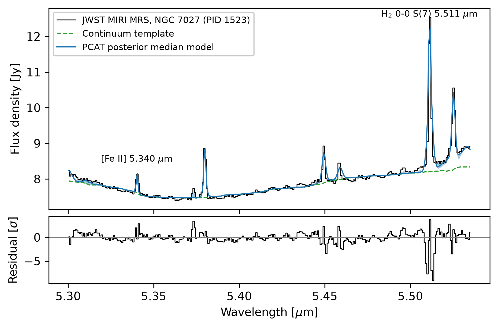

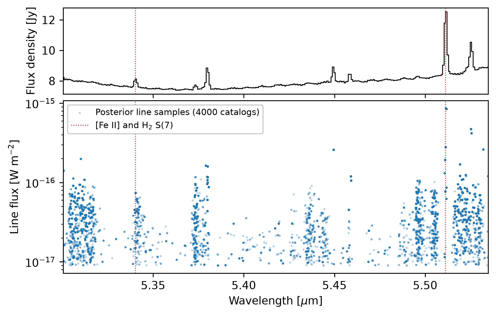

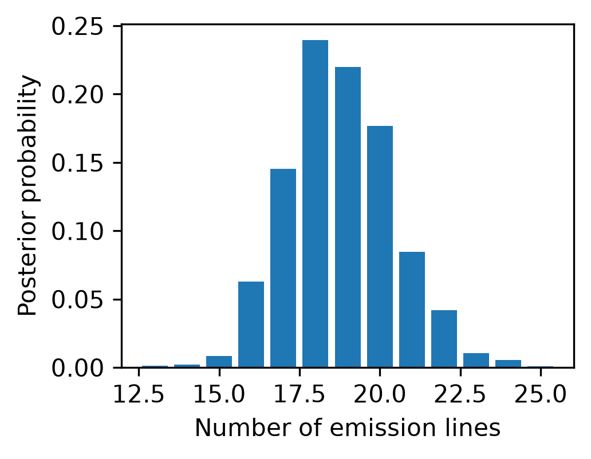

## Variable number of stellar flares

The example accepts `--output-root`, `--run-name`, and `--chains`. New runs use
timestamped names and preserve earlier posteriors. The default remains 12 chains.
Use `--skip-sampling --run-name NAME` to read an existing run without rewriting
the simulated input files.

The data are simulated: a quiescent star observed at a TESS-like 2 minute cadence for 1 day, with 3 to 6 injected fast-rise, exponential-decay (FRED) flares (`tdpy.retr_lcurmodl_flarsing`) at random peak times, amplitudes, and rise/decay time scales, and Poisson counts drawn around the expected count rate. PCAT reuses its one-dimensional element machinery for this time series. Time plays the role of the energy axis, and each flare is a native FRED component with a peak amplitude and independent rise and decay time scales on top of a fixed, flat quiescent baseline.

The inference model therefore represents the injected asymmetry directly. The catalog posterior jointly constrains the number of flares, their peak times and excess counts, and their separate rise and decay scales.

Install the optional example dependencies and run the 4,000-sweep-per-chain smoke check from the repository root with:

```bash
python -m pip install -e '.[examples]'
python examples/variable_number_stellar_flares/variable_number_stellar_flares.py --smoke
```

Omit `--smoke` for the default 100,000-sweep run. Sampling replaces the example's generated output state. Use `--skip-sampling` to rebuild figures from the existing posterior instead.

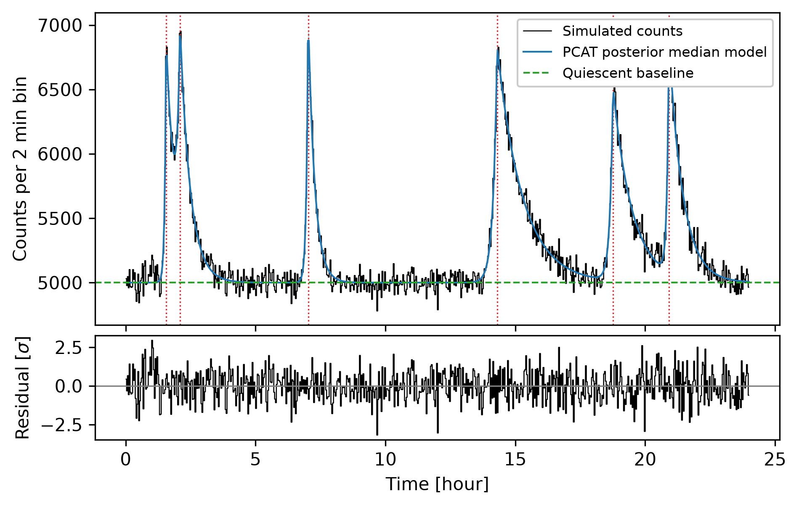

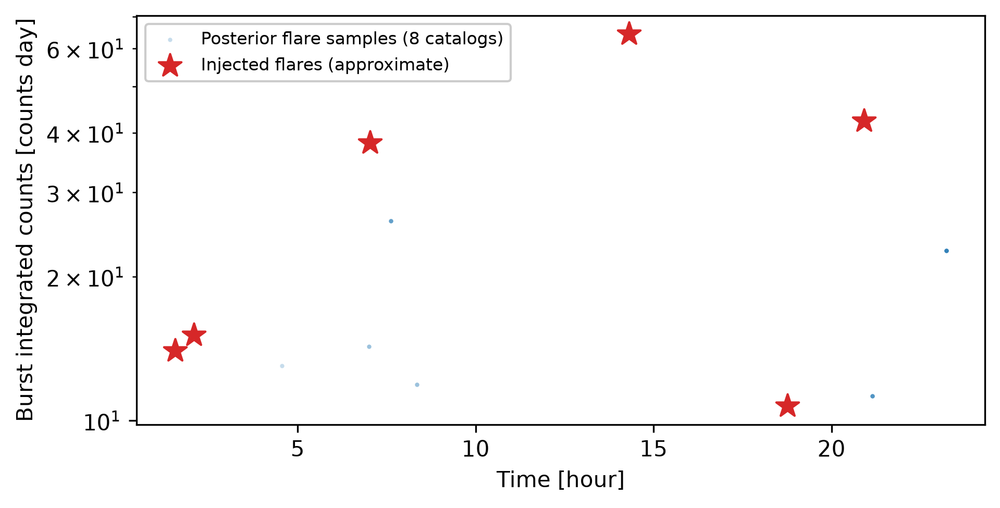

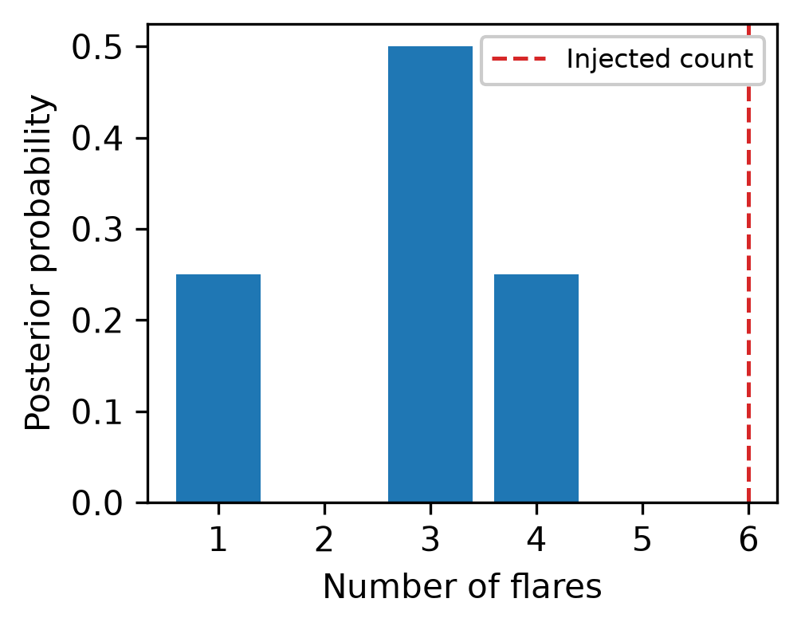

## Variable-number exoplanet radial velocities

This controlled simulation contains 120 irregular observations spanning six
years, with seasonal gaps and two spectrographs that have different velocity
zero points. Three Keplerian planets are injected with periods 5.77, 42.1, and
410 days and semi-amplitudes 12, 4, and 2.5 m/s. The reported uncertainty is
1.5 m/s, with 2 m/s of additional white stellar jitter. PCAT samples catalogs
with zero to five planets. Instrument offsets are marginalized analytically,
and jitter is marginalized on a 24-point log grid. The periodogram-weighted
birth and jump proposals include their Hastings correction.

Run the 100,000-sweep demonstration or the 1,000-sweep pipeline check from the
repository root:

```bash
python examples/variable_number_exoplanets_radial_velocity/variable_number_exoplanets_radial_velocity.py --numbswep 100000
python examples/variable_number_exoplanets_radial_velocity/variable_number_exoplanets_radial_velocity.py --smoke
```

The full run takes about 1.5 minutes on the documented machine. In the recorded
run, the injected three-planet model receives 92% posterior probability. The
1,000-sweep smoke run checks the pipeline; the reported posterior comes from the
100,000-sweep demonstration.

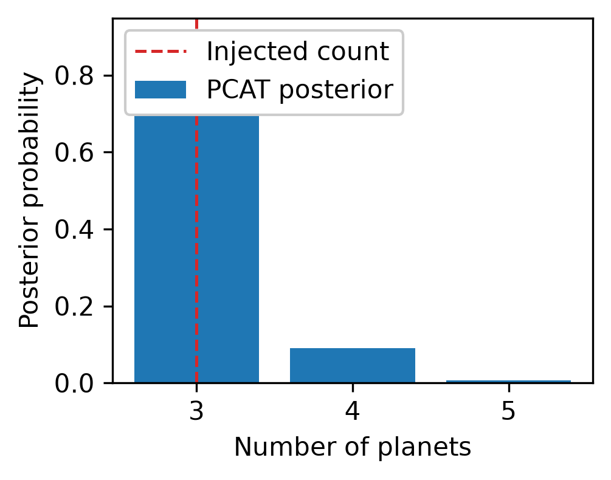

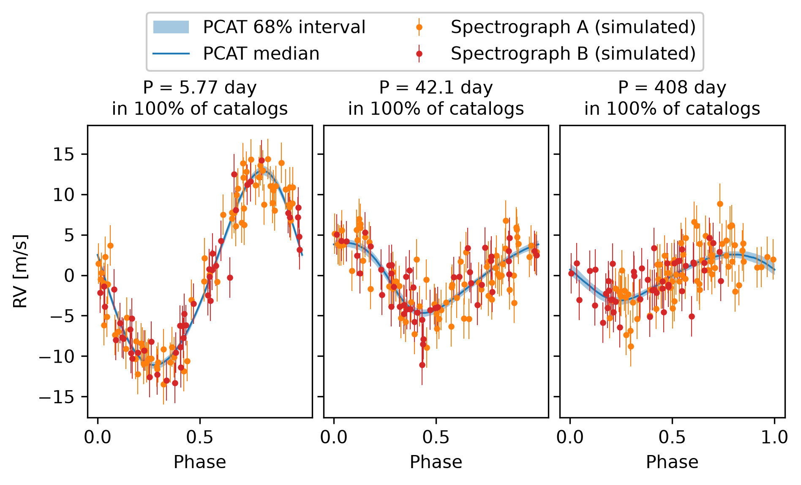

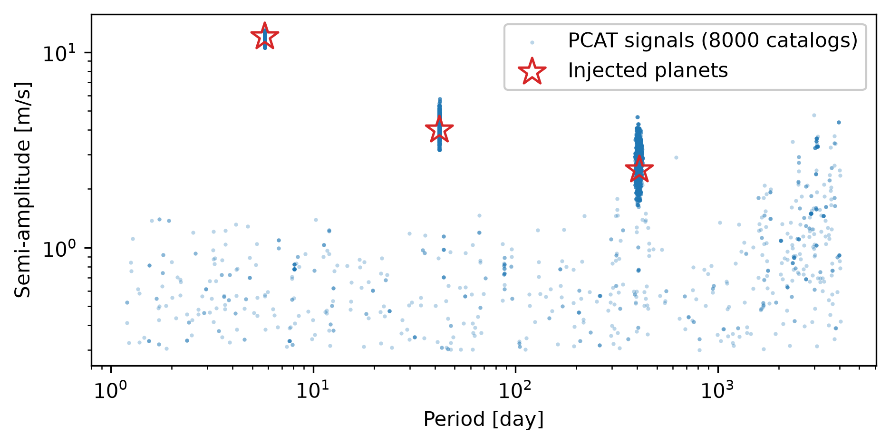

## Proposal profiling

PCAT stores the wall-clock time and proposal type of every sweep, as well as a breakdown of that time into internal pipeline phases. The maintained [profiling script](proposal_profiling/proposal_profiling.py) enables within-model, birth, death, split, merge, and jump moves and reports total sampler wall time, per-sweep timing, acceptance, and runtime share. In one 20,000-sweep, one-process run on the simulated Voigt spectrum, the recorded sweep time summed to 25.4 s (1.27 ms per sweep). Median sweep times were 0.36 ms for within-model, 0.46 ms for birth, 0.40 ms for death, 0.47 ms for split, 0.61 ms for merge, and 0.55 ms for jump proposals. Their respective shares of recorded sweep time were 25.7%, 0.9%, 42.4%, 0.3%, 21.0%, and 9.6%. These timings are specific to this run and machine.

Run the profile from the repository root with:

```bash
python examples/proposal_profiling/proposal_profiling.py --numbswep 20000
```

New sampling runs receive timestamped names and preserve earlier posteriors.
Use `--run-name` to choose a name and `--output-root` to keep a comparison's
chains and figures together in another directory. Existing run directories are
protected against overwriting. Use `--skip-sampling --run-name NAME` to
regenerate figures and the timing table from a named chain. Without a run name,
`--skip-sampling` reads the original example chain, including its older directory layout.

Most of the mean sweep time goes to bookkeeping around proposals (process, propose, parse, and save the state), not model evaluation, spectrum calculation, and likelihood together (0.075 ms per sweep in this run). A separate tertiary bookkeeping step that runs after each sweep, outside the recorded sweep total, costs 2.59 ms on average, about twice the mean sweep time, and remains a clear target for future speedups.

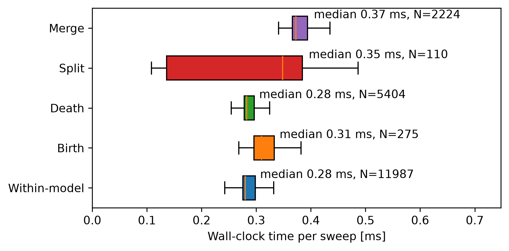

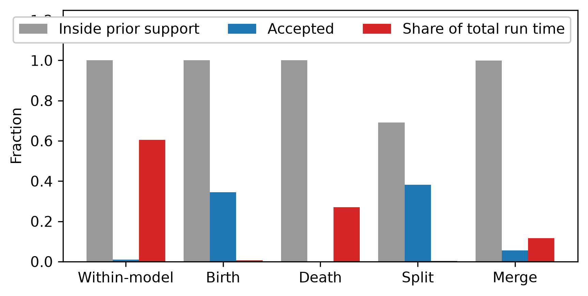

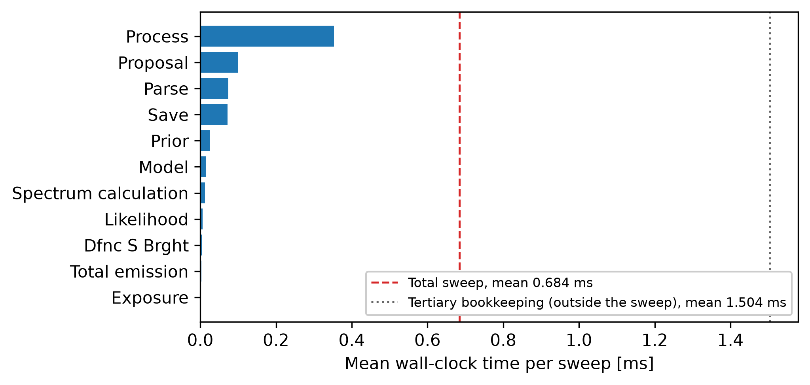

## Neural proposal efficiency

The benchmark trains a conditional neural density on simulated radial-velocity
systems, then compares prior, existing data-informed, and neural births on
disjoint held-out two-planet scenes, with two independent chains per method and
scene. Its fixed input uses 128 logarithmically spaced trial periods and stores
the log periodogram improvement, unit-scaled amplitude, and sine/cosine phase
at each period. Prior-redraw jumps are disabled to isolate birth/death proposal
densities. Paired runs use the same likelihood, priors, count model,
initialization seeds, and sweep budget. The output reports count-chain R-hat,
catalog-count-posterior total variation, count and log-likelihood effective
sample size (ESS), ESS per likelihood call and per second, training-amortized
ESS per second, birth/death acceptance, training time, and bootstrap
intervals across validation scenes. A gain requires well-mixed chains,
adequate posterior agreement, and favorable efficiency ratios. Acceptance rate
alone does not establish faster exploration. The script marks a gain supported
only when the lower 95% paired
bootstrap bounds for both count and log-likelihood ESS per call exceed 1, all
count and log-likelihood R-hat values are at most 1.1, median count-posterior
total variation is at most 0.1, and the lower 95% paired bootstrap bound for
training-amortized count ESS per second exceeds 1 against each baseline.

The available 12,000-sweep pilots each used one held-out scene and two chains
per method. With a 5% uniform proposal component, neural count ESS per call
was 0.48 times the prior value, count R-hat was 1.37, and count-posterior
total variation from the prior was 0.43. With a 50% uniform component, these
values were 0.93, 1.23, and 0.13. The neural log-likelihood ESS-per-call ratio
was 0.77 and log-likelihood R-hat was 3.75. Neither pilot passed the stated
criteria. The single-scene bootstrap intervals do not measure scene-to-scene
variability, and these runs do not support an efficiency or posterior-recovery
claim.

Both pilots used the data-only callback. They do not evaluate the
state-conditioned callback interface.

A separate 400-sweep state-conditioned smoke run used one held-out scene and
two chains. It did not pass count-posterior agreement, with total-variation
distances of 0.32 from the prior baseline and 0.75 from the data-informed
baseline. It verifies benchmark execution only and is not a performance result.

To run a multi-scene state-conditioned comparison, provide a fresh run ID:

```bash
python examples/neural_proposal_efficiency/neural_proposal_efficiency.py \
	--proposal-conditioning state \
	--run-id state_conditioned_efficiency_v1
```

The run stores its conditioning mode, training dimensions, seeds, environment,
and per-chain traces in the result JSON. Do not interpret the smoke run as an
efficiency estimate.

One completed three-scene, 12,000-sweep-per-chain state-conditioned run gave
count ESS per likelihood call ratios of 0.029 versus prior (95% scene-bootstrap
interval 0.029 to 0.60) and 1.20 versus data-informed (0.11 to 1.53). Median
count-posterior total variation was 0.44 and 0.57 against those baselines. The
neural log-likelihood R-hat values were 1.35, 1.00, and 2.32, with two scenes
above 1.1. The pre-specified efficiency check failed. This result is specific
to the current training setup and is not a general limit on state-conditioned
proposals.

The experimental ``--state-feature-mode residual`` option recomputes the
periodogram after subtracting the current catalog model. A one-scene smoke run
confirms execution. Comparative performance has not been measured for this
feature mode.


I report zero ESS for constant count traces as a conservative convention,
including traces shorter than four samples. Missing, masked, or nonfinite
samples raise an error instead of producing an efficiency score. This
convention does not establish convergence of the catalog or its parameters.
Efficiency comparisons with a zero-ESS baseline are undefined and reported as
`NaN`, including zero divided by zero. Their bootstrap intervals remain
undefined and cannot support an efficiency-gain claim. Zero neural ESS with a
positive baseline retains a ratio of zero. Existing saved results are not
rewritten automatically.
Bootstrap comparisons must be one-dimensional and use a positive integer
resampling budget. Empty, masked, or nonfinite comparisons produce an undefined
interval without resampling, filling values, or dropping scenes. Valid finite
inputs retain their seeded intervals exactly.
Count R-hat is undefined (`NaN`) when all chains stay at the same count.
Constant chains stuck at different counts retain infinite R-hat. Neither case
provides mixing evidence, and the efficiency-claim checks require finite
per-scene R-hat values for both compared methods.
The gain predicate also requires fully available, aligned one-dimensional
evidence for the same validation scenes and ordered two-bound confidence
intervals. Masked, empty, scalar, matrix, or mismatched evidence and malformed
intervals cannot support a gain claim. Values are not filled or silently dropped,
and the existing gain, mixing, and posterior-agreement thresholds are unchanged.
ESS and R-hat share a full-trace check for missing or nonfinite samples. R-hat
validates before aligning unequal chain lengths, so unavailable prefix samples
cannot disappear during alignment. Valid unequal-length inputs still use the
final samples up to the shortest chain's length. No missing values are filled.
The reported median count R-hat includes every validation scene. If any scene's
value is undefined, that aggregate remains `NaN`. Undefined scenes are not
silently removed, and an all-undefined collection produces no median warning.
Each chain must supply a positive integral likelihood-call count and a finite
positive elapsed time. Training overhead must be finite and nonnegative, with
absent overhead treated as zero. Invalid costs raise `ValueError` before
aggregation. Call counts are summed as Python integers without truncation.
The benchmark's ESS estimator caps its output at the retained sample count.
Each supplied count or log-likelihood ESS must therefore be a finite real
scalar between zero and its own trace length. Invalid metadata raises
`ValueError` before aggregation. Values are neither clipped nor recomputed,
and valid fractional or zero ESS values are retained.
Per-chain birth and death acceptance rates must also be finite real scalars in
`[0, 1]`. Invalid or masked rates raise `ValueError` before averaging. Valid
zero and unit acceptance rates retain their existing equal-chain means, without
clipping or changing the underlying proposal counts.
Saved acceptance flags are checked before Boolean conversion. Proposal IDs
must be finite nonnegative integers, acceptance values must be binary zero/one,
and the flattened traces must have matching lengths. Invalid HDF5 metadata
raises `ValueError`. Other nonnegative proposal IDs remain available for future
move types, and a move with no recorded attempts retains its existing zero rate.
Posterior count and log-likelihood traces must be nonempty and have matching
flattened lengths. Raw count values must be finite integers in the supported
planet-count range before integer conversion. Log-likelihood samples must be
finite real numbers. Invalid traces raise `ValueError` before ESS or posterior
probabilities are computed, without truncating counts, clipping, or rewriting
the HDF5 file.
Count-posterior summaries retain equal weights for each chain, including chains
with unequal retained lengths. Each input distribution must cover every
supported count with finite real probabilities in `[0, 1]` and sum to one within
its floating-point rounding tolerance. Invalid or masked distributions raise
`ValueError` before averaging. Probabilities are not filled, clipped, or
renormalized.

Run the five-scene comparison from the repository root with:

```bash
python examples/neural_proposal_efficiency/neural_proposal_efficiency.py
```

Use `--smoke` to check the complete training-and-sampling path quickly. Its
two short chains per proposal method check execution. They do not establish
convergence or performance.

Choose a fresh `--run-id` for each comparison. Existing checkpoints, results,
efficiency figures, or configured chain outputs raise `FileExistsError` before training
starts, preserving those artifacts. Use one process for each run ID.

## PCAT, emcee, and dynesty

The simulated dataset contains 40 epochs over 30 d of a 5 m/s sinusoid with a 3.7 d period and 2 m/s noise. The three samplers share the likelihood and uniform priors on amplitude (0 to 15 m/s), period (2 to 6 d), and phase (0 to 2&pi;). PCAT (60,000 sweeps, adaptive proposal scales) and dynesty (500 live points) place all samples in the true period mode and agree on the marginal posteriors, e.g. period 3.722 &plusmn; 0.023 d. emcee (16 walkers, 4,000 steps, initialized across the prior) places 12% of its samples in secondary period modes, so its effective sample size (ESS) is not meaningful. dynesty is the most efficient on this fixed-dimensional problem, with 900 effective samples per second against 35 for PCAT, and it also returns the log-evidence, &minus;23.7 &plusmn; 0.3. PCAT evaluates the likelihood 2.6 times per sweep in this mode. Its distinct capability is transdimensional sampling, where neither emcee nor dynesty can change the number of model components within one run.

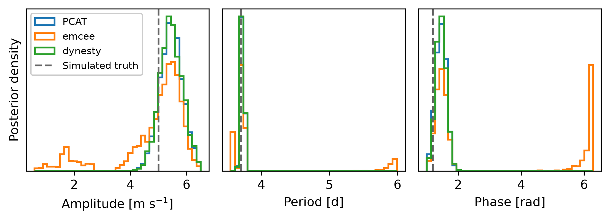

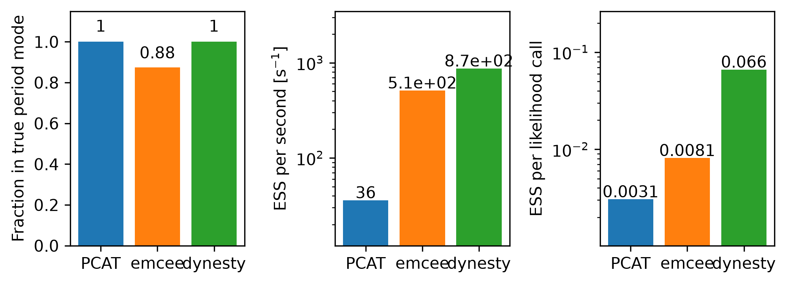

The same script also compares transdimensional model selection on 60 simulated
radial-velocity epochs containing two planets. PCAT samples zero through three
planets in one run. dynesty requires a separate evidence calculation for each
planet count, and emcee cannot vary the number of planets. The count posterior,
two-planet periods, likelihood-call total, and runtime show both the agreement
and cost of these different approaches.

Run both experiments from the repository root:

```bash
python examples/sampler_comparison_emcee_dynesty/sampler_comparison_emcee_dynesty.py --part both
```

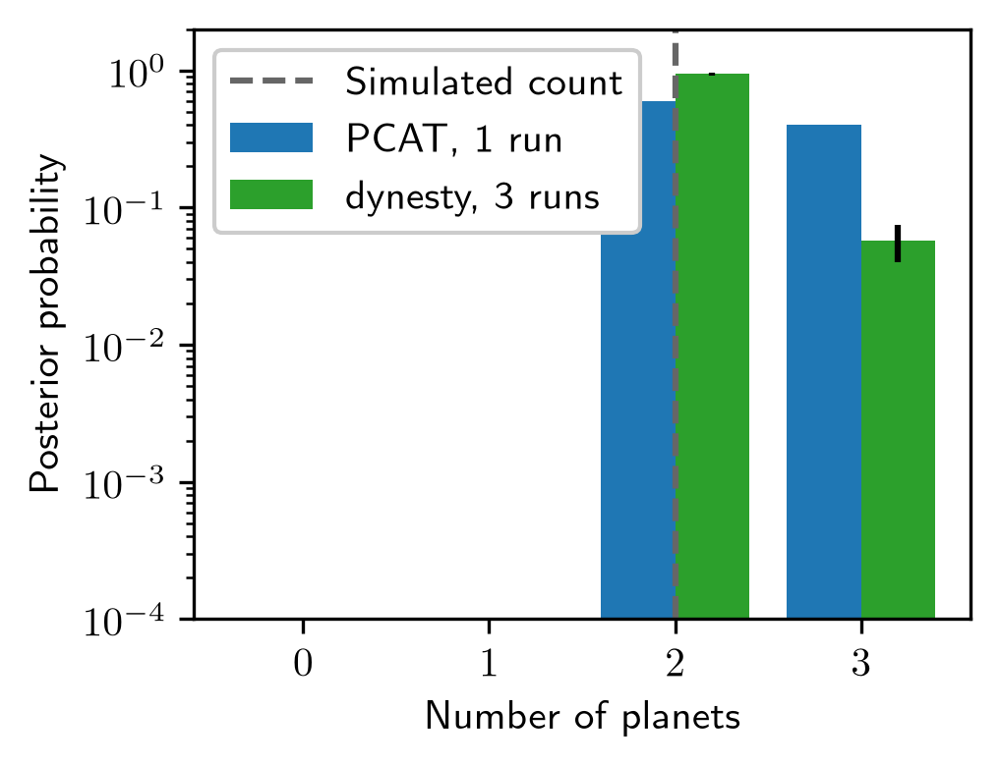

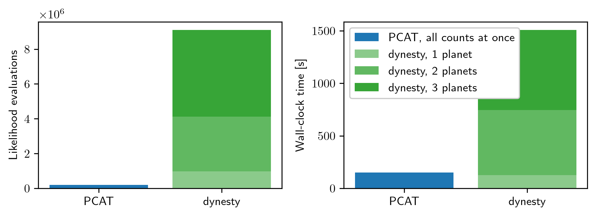

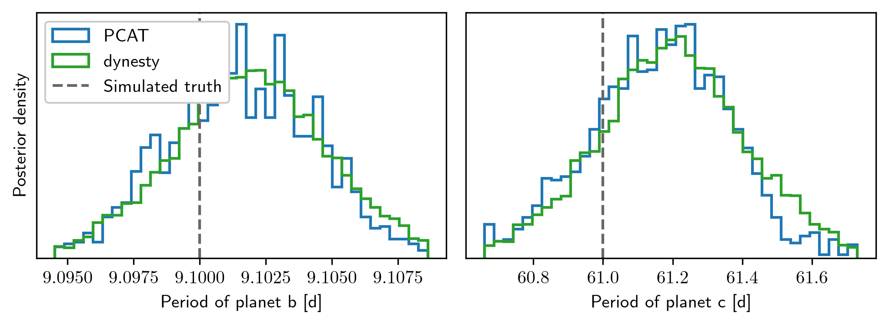

## Running

From the repository root:

```bash
cd /path/to/pcat
python examples/run_all_examples.py
```

The aggregate script replaces cached figure outputs for the included analyses. It evaluates the image analyses, the Roman strong-lens benchmark, the two utility examples, and the reduced Voigt configuration. The output includes posterior plots and animations.

Run either Voigt configuration at its full sampling depth with:

```bash
python examples/voigt_spectral_line_catalog/voigt_spectral_line_catalog.py --configuration nomi
python examples/voigt_spectral_line_catalog/voigt_spectral_line_catalog.py --configuration s2nrhigh
```

Install the optional example dependencies from the repository root:

```bash
python -m pip install -e '.[examples]'
```

The JWST example downloads its real MIRI spectrum from MAST on first run, so it needs network access:

```bash
python examples/jwst_miri_ngc7027_line_catalog/jwst_miri_ngc7027_line_catalog.py
```
